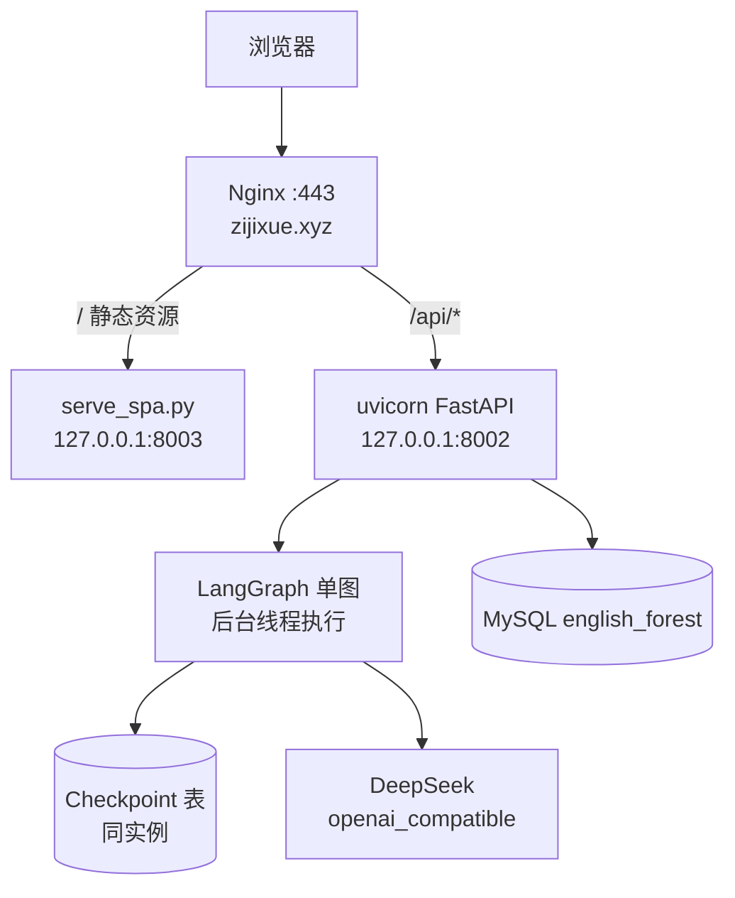
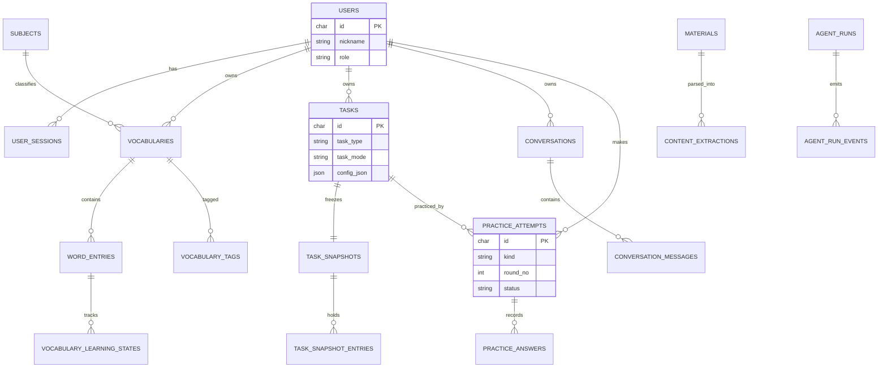

# ARCHITECTURE — 家庭学习助手（as-built 现状版）

- **首次创建**：2026-11-20（由 `I-intel-scan` + 代码实测生成）
- **最近修订**：2026-11-20
- **当前 ADR 编号最大值**：ADR-016
- **代码基线**：`main @ cf5f18f` + 工作区 11 个未提交改动

> **本文件与另外两份文档的边界**
>
> | 文件 | 回答什么问题 | 性质 |
> |---|---|---|
> | `.specs/CONTEXT.md` | AI 写代码时该遵守什么（栈、命名、既有抽象、禁动清单）| rules 层 |
> | **`.specs/ARCHITECTURE.md`（本文件）** | **系统现在是怎么搭起来的** | **as-built 现状** |
> | `docs/家庭学习助手系统架构与开发设计文档 V1.0.md` | 系统原本打算怎么搭 | **设计意图（不删不改）** |
>
> **冲突时以本文件为准**。V1.0 是 2026-11 上旬的设计目标，其中 Agent Workflow 划分、Dictation 模块、Handler Registry 三处已被实现推翻或未落地，差异见 §1.4。

---

## 1. 系统概览

### 1.1 一句话定位

面向家长的 AI 学习助手：家长用自然语言驱动 Agent，把 Excel/CSV 教材变成可练习的词库与听写任务，并在独立学习页完成练习与记录。
**Agent 是入口，业务页面与 Agent 共用同一套 Service**；MVP 只有 Vocabulary + Dictation 两种学习类型。

### 1.2 运行时拓扑（生产）



- 一个 systemd 单元托管两个进程：`uvicorn` + `serve_spa.py`，`wait -n` 互保（`deploy/project2-start.sh`）。
- **单实例、单 worker**；Agent 在进程内 `threading.Thread` 执行，靠全局执行锁串行化（`agent/runtime.py`）。
- 前端产物必须本地构建后上传（服务器无 Node/npm/uv）。

### 1.3 关键非功能性基线

| 维度 | 当前基线 | 来源 |
|---|---|---|
| 只读接口延迟 | P95 **51.78 ms**（300 请求 / 20 并发 / 0 错误）| `docs/开发进度.md:41` |
| Agent 单次 SSE 流上限 | **300 s**（到点主动终止）| `agent/runtime.py:578` |
| 上传大小 | 应用层 **10 MB**；Nginx **20 MB** | `core/config.py:26`、交接文档 §3.2 |
| 单任务规模实测 | 最大 **7,956 词**，详情接口约 **1.5 MB** | 交接文档 §13.1 |
| Agent 大字段峰值 | `pending_action_json` ≈ **319k 字符** | 交接文档 §13.1 |
| 水平扩展 | **不可**（单 worker + 进程内线程 + 全局锁）| `agent/runtime.py` |
| 可用性目标 | 未定义 SLA | — |
| 数据规模 | 20 张业务表 + 49 张 `legacy_*` 保留表 | `grep __tablename__`、交接文档 §13.2 |

> 任何触碰「单实例假设」「SSE 300s」「大字段」的 change，2-design 必须显式评估。

### 1.4 与设计意图（V1.0）的差异 — as-built 声明

| # | V1.0 设计意图 | 现状 | 处置 |
|---|---|---|---|
| A1 | 4 个 Subgraph：Material / Vocabulary / Task / Learning | 单图 5 节点：`classify → tool_create → prepare → wait → respond`；业务解析在 `prepare` 内 | 见 ADR-001；V1.0 §5.4 视为**已废弃** |
| A2 | Dictation 独立模块，拥有听写数据 | 无该模块、无听写表；配置在 `tasks.config_json`，判定在 `practice/service.py` | 视为**设计已收敛**，待用户最终确认 |
| A3 | Task/Practice 通过 Handler Registry 隔离学习类型 | 无 Handler 抽象，`task_type` 分支内联在 service | 视为**延后实现**（第三种学习类型出现时再做） |
| A4 | §3.3 禁止跨模块访问 Repository | 9 处直连：`agent`→5、`practice`→3、`task`→1 | 记为技术债 TD-A（§7） |
| A5 | 业务路由集中在 `app/api/routes/` | 路由随模块走 `modules/<m>/router.py` | 已采纳为事实标准 |
| A6 | 部署在 `yidongxun.com` 根路径 | 域名 `https://zijixue.xyz`，前端 base `/`（2026-11-20 迁移完成） | 见 ADR-011；V1.0 该段为历史 |

---

## 2. 模块清单 + 边界

### 2.1 模块表

| 模块 | 路径 | 职责 | 拥有的表 | 对外暴露 |
|---|---|---|---|---|
| `user` | `backend/app/modules/user/` | 注册登录、JWT、Refresh Session、账户设置 | `users`、`user_sessions` | `/auth/*`、`/users/me` |
| `vocabulary` | `modules/vocabulary/` | 学科、词库、标签、词条、掌握状态、公共词库发布/撤回/复制 | `subjects`、`vocabularies`、`vocabulary_tags`、`word_entries`、`vocabulary_learning_states` | `/vocabularies/*`、`/subjects` |
| `material` | `modules/material/` | 原始文件落盘与元数据 | `materials` | `POST /materials` |
| `content` | `modules/content/` | XLSX/CSV 解析、表头映射、字段补全、预览草稿 | `content_extractions` | `/materials/{id}/extractions`、`/content/*`、模板下载 |
| `task` | `modules/task/` | 任务、快照、固定/长期模式、听写配置、进度 | `tasks`、`task_snapshots`、`task_snapshot_entries` | `/tasks/*` |
| `question` | `modules/question/` | 题目生成与存储（**无外部路由**）| `questions` | 仅内部 Service |
| `practice` | `modules/practice/` | 练习生命周期、答题、判分、错题、轮次 | `practice_attempts`、`practice_answers` | `/tasks/{id}/attempts*`、`/attempts/*` |
| `learning` | `modules/learning/` | 学习统计（只读聚合，无自有表）| — | `GET /learning/stats` |
| `conversation` | `modules/conversation/` | 会话与消息（`text`/`tool_call`/`tool_result`）| `conversations`、`conversation_messages` | `/conversations/current*` |
| `agent` | `modules/agent/` | 意图分类、LangGraph、Tool Registry/Executor、SSE、执行详情、能力引导兜底 | `agent_runs`、`agent_run_events` | `/agent/*` |
| `admin` | `modules/admin/` | 用户管理、公共资源、操作日志、Checkpoint 巡检 | `operation_logs` | `/admin/*` |

### 2.2 依赖规则

```
✅ 事实上的允许方向
router → service → repository → model
service → 其它模块的 Service（跨模块业务）
agent   → 各模块 Service / Repository（编排层，见 §2.3 例外）

❌ 架构红线（V1.0 §3.3，仍然有效）
- 模块直接访问其它模块的 Repository / 数据表
- Agent 绕过 Service 写库
- 前端自行实现业务规则
- Tool 内重复实现 Service 业务规则
- 把 LangChain 对象当业务表结构
```

### 2.3 现存越界（9 处 · 已登记技术债）

| 模块 | 越界 import | 影响 |
|---|---|---|
| `agent/service.py:13-24` | `ContentRepository`、`MaterialRepository`、`PracticeRepository`、`TaskRepository`、`VocabularyRepository` | 编排层直接构造他模块 Repository，替换实现需改 Agent |
| `practice/service.py:22-26` | `QuestionRepository`、`TaskRepository`、`VocabularyRepository` | 练习直接读任务快照与词库，绕过对方 Service 的权限/规则 |
| `task/service.py:20` | `VocabularyRepository` | 建任务时直接读词条 |

**新增代码一律走对方 Service**；存量按功能迭代收敛，不为此单独立项。

### 2.4 Agent 请求生命周期（实测）

```text
POST /agent/runs/stream
  └─ 建 agent_run（status=running, lease 2min）+ 存 user 消息 + 发 progress 事件
       └─ 后台线程 graph.invoke
            ├─ classify   ← LLM 输出 8 类 route（带最近 6 条文本历史）
            ├─ tool_create ← 仅 task_create 且开关开启：受限工具集 + 原生 tool_calls
            ├─ prepare    ← 其余路由：Python 正则解析 + Service 读 + 组装 pending_action
            ├─ wait       ← LangGraph interrupt，等确认
            └─ respond    ← 对话回答 / 学习统计 / 能力引导兜底
       └─ 写 assistant 消息 + SSE 事件（message / confirmation_required / done / error）
POST /agent/actions/{run_id}/confirm
  └─ Command(resume) → wait 继续 → business.execute → 各模块 Service 正式写入
```

意图路由枚举（`agent/llm.py:472-474`）：`task_create` / `task_update` / `task_delete` / `vocabulary_create` / `vocabulary_import` / `learning` / `chat` / `unclear`。

---

## 3. ADR 列表（已生效的项目级决策）

> 每条都可追溯到 `docs/技术决策记录.md` 的 TD 编号；TD-15（原型交互裁决）属 UI 细节，未升为 ADR。

### ADR-001 · Agent 形态：单 Agent + 单图 + 场景工具集

- **状态**：accepted（2026-11-05），**取代 V1.0 §5.4 的"4 个 Subgraph"**
- **取舍**：每业务一个 Subgraph / 单图 + 场景受限工具集
- **决定**：单张 `StateGraph`，`classify` 定路由，写入类场景走 `tool_create`（原生 Tool Calling），未接入场景暂留 `prepare` 正则
- **理由**：Subgraph 划分会让 4 条链路各写一套解析；工具集能复用同一套 Schema/权限/Executor
- **代价**：过渡期存在两条链路（正则 + 工具调用），由 `FLA_AGENT_TOOL_CALLING_ENABLED` 切换
- **推翻成本**：中（路由与 State 契约稳定，节点可替换）

### ADR-002 · 任务创建时冻结词条快照

- **状态**：accepted
- **决定**：`task_snapshots` + `task_snapshot_entries` 存词条拷贝；固定任务内容不可改，长期任务用稳定快照练习
- **理由**：词库后续增删改不能影响已建任务的练习内容与统计口径
- **代价**：存储放大；超大任务详情 ~1.5 MB
- **推翻成本**：高（历史任务与答题记录均引用快照）

### ADR-003 · 写操作确认协议 `action_id + draft_version + config_hash`

- **状态**：accepted（TD-05）
- **决定**：`action_id` = run id；每次编辑递增 `draft_version` 并重算 `config_hash`；确认必须携带最新二元组，Run 状态机阻止重复确认产生二次副作用
- **理由**：LLM 生成与用户确认之间会漂移，必须防"确认了旧草稿"
- **代价**：每次编辑多一次哈希计算与状态写入
- **推翻成本**：高（前端、runtime、Service 三处耦合）

### ADR-004 · LangGraph Checkpointer 用 MySQL（生产）/ SQLite（开发）

- **状态**：accepted（TD-04）
- **决定**：`langgraph-checkpoint-mysql`；库排序规则必须 `utf8mb4_0900_*`，推荐独立库
- **理由**：Workflow 中断/恢复与服务重启续跑需要持久化
- **代价**：多一套表；排序规则配错会直接报错
- **推翻成本**：低（接口是标准 Saver）

### ADR-005 · Agent 事件持久化 + 序号重放，Graph 与 SSE 解耦

- **状态**：accepted（TD-03 / TD-09）
- **决定**：事件写 `agent_run_events`，唯一约束 `(run_id, sequence)`；SSE 端点只轮询并发送，客户端用 `after_sequence` 补发；Graph 在后台线程跑，断线不取消
- **理由**：断网/刷新/代理超时不该中断业务，也不能重复产生副作用
- **代价**：事件表持续增长，需清理策略（未定）
- **推翻成本**：中

### ADR-006 · Tool 权限在 Registry 与 Service 双侧校验

- **状态**：accepted（TD-08）
- **决定**：Registry 按角色 + workflow 过滤暴露给 LLM；Executor 每次执行重新校验；身份由后端注入，Schema 无身份字段且 `extra="forbid"`
- **理由**：模型输出不可信，"工具没暴露"不等于"不能执行"
- **代价**：同一权限判断写两处，需保持一致
- **推翻成本**：低

### ADR-007 · 前端只依赖 `api` 组合根

- **状态**：accepted（TD-01）
- **决定**：页面 import `api`，不直接 `fetch` / `localStorage`；Mock 仅在 `VITE_API_MODE=mock` 启用
- **理由**：替换数据源（HTTP ↔ Mock）不触碰页面
- **代价**：每加一个接口要同步 `httpApi` 与 `mockApi` 两份签名
- **推翻成本**：低

### ADR-008 · 短期 JWT + 数据库可撤销 Refresh Session

- **状态**：accepted（TD-02）
- **决定**：Access 30 min（带 `jti`），Refresh 30 天，轮换即撤销旧会话
- **理由**：支持登出/停用/撤销，同时避免每请求查会话表
- **代价**：需要 `user_sessions` 表与轮换逻辑
- **推翻成本**：中（涉及全部登录态）

### ADR-009 · 统一 LLM Provider：DeepSeek OpenAI-compatible

- **状态**：accepted（TD-16）
- **决定**：`openai_compatible` + `deepseek-v4-flash`；Key 只存 `.env`，仓库留占位
- **理由**：开发/演示/生产同一实现，减少适配分支；已验证原生 tool_calls
- **代价**：绑定单供应商；函数名不允许点号（内部名转下划线）
- **推翻成本**：低（Adapter 层隔离）

### ADR-010 · Excel 导入「规则优先、模型兜底」

- **状态**：accepted（TD-13 / TD-14）
- **决定**：同义词精确匹配优先；失败才把表头 + ≤5 行样例交 LLM；输出必须服务端二次校验；字段补全只填空、绝不覆盖用户内容
- **理由**：多数表头可确定性映射，不必付模型成本；模型输出不可直接写库
- **代价**：两套映射逻辑 + 校验代码
- **推翻成本**：低

### ADR-011 · 部署拓扑：单机 systemd + 本地构建 + `zijixue.xyz`

- **状态**：accepted（2026-11-20 更新），**取代 V1.0 中 `yidongxun.com` 根路径方案**
- **决定**：一台腾讯云轻量主机，`project2.service` 托管 `uvicorn:8002` + `serve_spa.py:8003`，Nginx 对外；对外域名 **`https://zijixue.xyz`** 根路径（`yidongxun.com` 已停止服务，`sunxinshan.site/zijixue` 保留 301）；前端 base 为 `/`
- **理由**：服务器无 Node/npm/uv，构建必须本地做；单机足够当前用户量；独立域名根路径让 base 与路由 basename 都回到 `/`，少一层前缀剥离
- **代价**：发布流程重（本地构建 + 上传 + 切软链 + 重启）；无法水平扩展
- **推翻成本**：中（需容器化或加 Worker 层）

### ADR-012 · 删除任务走两阶段确认

- **状态**：accepted（TD-06）
- **决定**：第一次确认只生成"二次确认动作"并递增版本，第二次确认才调 `TaskService.delete`
- **理由**：不可逆操作需要一次额外的意图确认
- **代价**：前端需处理两轮确认态
- **推翻成本**：低

### ADR-013 · 执行详情递归脱敏

- **状态**：accepted（TD-07）
- **决定**：用户仅见自己的 run，管理员可见全部；返回前屏蔽 key 含 token/password/cookie/secret/credential 的字段，并替换 Bearer / `sk-` 文本
- **理由**：执行详情会透出 Prompt 与工具参数，容易泄露凭据
- **代价**：脱敏递归有性能成本
- **推翻成本**：低

### ADR-014 · 生产管理员通过环境变量 Bootstrap

- **状态**：accepted（TD-12）
- **决定**：`FLA_BOOTSTRAP_ADMIN_*` 两组；仅当昵称不存在时创建，不覆盖已有密码；不在迁移里写死密码
- **理由**：迁移文件会进 Git，不能承载生产凭据
- **代价**：首次部署需人工注入
- **推翻成本**：低

### ADR-015 · 安全响应头与基础指标

- **状态**：accepted（TD-11）
- **决定**：`X-Content-Type-Options` / `X-Frame-Options` / `Referrer-Policy` / `Permissions-Policy`；`/health/metrics` 提供请求数、错误数、状态分类、延迟
- **理由**：低成本合规与可观测基线
- **代价**：`/health/metrics` 目前公网可达，需评估限制
- **推翻成本**：低

### ADR-016 · 前端 Token 刷新单例

- **状态**：accepted（TD-10）
- **决定**：401 时共享同一个 Refresh Promise，轮换后只重试一次原请求
- **理由**：并发请求各自刷新会把 Refresh Token 互相作废
- **代价**：逻辑集中在 `httpClient`
- **推翻成本**：低

---

## 4. 跨模块契约

### 4.1 公共 HTTP API（`/api/v1` 前缀）

```
/health        GET /live · /ready · /metrics
/auth          POST /register · /login · /refresh · /logout · GET /context
/users         GET|PATCH /me · POST /me/password
/subjects      GET /
/vocabularies  GET / · POST / · GET|PATCH|DELETE /{id} · POST /{id}/copy
               PATCH /{id}/visibility · POST /{id}/publish · /{id}/unpublish
               POST /{id}/entries · PATCH|DELETE /{id}/entries/{entryId}
               POST /{id}/entries/batch-delete · GET /import-template
/materials     POST /            （multipart，仅 .xlsx/.csv，≤10MB）
               GET  /{id}/extractions · GET /import-template
/content       GET|PATCH /extractions/{id} · POST /extractions/{id}/confirm
/tasks         GET / · POST / · GET|PATCH|DELETE /{id}
/practice      POST /tasks/{id}/attempts · /tasks/{id}/wrong-attempts
               GET  /tasks/{id}/wrong-questions · /tasks/{id}/attempts/active
               GET  /attempts · /attempts/{id}
               POST /attempts/{id}/answers · /attempts/{id}/self-check
/learning      GET /stats
/conversations GET /current · POST /current/messages · DELETE /current/messages
/agent         POST /runs/stream（SSE）· GET /runs/active · /runs/{id}
               GET  /runs/{id}/details · /runs/{id}/events?after_sequence=
               PATCH /actions/{id}/draft · POST /actions/{id}/confirm · /actions/{id}/cancel
/admin         GET /users · PATCH /users/{id}/status · POST /users/{id}/reset-password
               GET /users/{id}/learning-stats · GET /logs
               GET /checkpoints · /checkpoints/{threadId}/{checkpointId}（未提交）
```

约定：错误体固定 `{error:{code,message,details,request_id}}`；身份字段永不进请求体。

### 4.2 SSE 事件契约

| event_type | 载荷要点 |
|---|---|
| `progress` | `stage`（thinking / executing）、`message` |
| `message` | 助手文本 |
| `tool_status` | 工具名、参数、结果、耗时、成功/失败 |
| `confirmation_required` | `pending_action`（含 `action_id`、`draft_version`、`config_hash`）|
| `done` | `executionId`、run 状态 |
| `error` | `code`、`message` |

序号单调递增，持久化于 `agent_run_events.sequence`；断线重连带 `after_sequence` 续传。Run 终态：`completed` / `failed` / `cancelled`。

### 4.3 数据模型（顶层关系）



### 4.4 共享配置项（`FLA_` 前缀，`core/config.py`）

| 配置 | 默认 | 影响 |
|---|---|---|
| `FLA_DATABASE_URL` | `sqlite:///./data/dev.db` | 全部模块（只允许 sqlite/mysql scheme）|
| `FLA_CHECKPOINT_BACKEND` / `_URL` | `sqlite` | Agent 恢复能力 |
| `FLA_JWT_SECRET` / `_ACCESS_TOKEN_MINUTES` / `_REFRESH_TOKEN_DAYS` | 30 / 30 | 认证 |
| `FLA_LLM_PROVIDER` / `_BASE_URL` / `_MODEL` / `_API_KEY` | `mock` | 意图分类、工具调用、表头映射、字段补全 |
| `FLA_AGENT_TOOL_CALLING_ENABLED` | `false`（**生产 = true**）| Agent 走工具调用还是正则 |
| `FLA_UPLOAD_DIR` / `FLA_MAX_UPLOAD_BYTES` | `./data/uploads` / 10MB | material |
| `FLA_MASTERY_THRESHOLD` / `FLA_REVIEW_INTERVALS_DAYS` | 2 / `[1,3,7,14]` | practice / learning |
| `FLA_CORS_ORIGINS` | 本地 5173 | 生产仅站点域名 |

---

## 5. 扩展点（新东西往哪加）

| 想加什么 | 加在哪 | 关键约束 |
|---|---|---|
| 新后端接口 | `modules/<domain>/router.py` | `main.py` 注册；权限走 `Depends(get_runtime_context)` |
| 新业务模块 | `modules/<name>/{router,service,repository,models,schemas}.py` + `core/model_registry.py` | 新模型要在 `model_registry.py` 导入并加入 `__all__`（现状 `Subject` 未进 `__all__`，属小疏漏）|
| 新 Agent 工具 | `agent/tools.py` 注册 + `agent/tool_schemas.py` 定义 | 必须有真实 Handler、`extra="forbid"`、无身份字段、`workflows` 标签 |
| 新 Agent 场景 | `agent/llm.py` 路由枚举 + `runtime.py` 分支 + `agent/prompts/` | 同步更新 `capability_guide.md`（仅增量，见 AGENTS.md）|
| 新学习类型 | `task_type` + `practice` 判定 + `question` 生成 | 现无 Handler 抽象；出现第三种类型时再抽 |
| 新 Prompt | `agent/prompts/*.txt` + `prompt_registry.py` | 版本与哈希会随 run 记录 |
| 新前端页面 | `pages/*Page.tsx` + `router/AppRouter.tsx` | 只用 `api`，不直接 fetch |
| 新前端接口 | `api/httpApi.ts` + `api/mockApi.ts` | 两份签名必须同步 |
| 新数据库变更 | `alembic/versions/` 追加迁移 | 禁止改历史 revision；必须可逆 |

---

## 6. 容量 / 性能边界

| 边界 | 当前值 | 触发什么 |
|---|---|---|
| 后端进程数 | 1（systemd 单实例）| 加实例前必须先做共享队列 + 独立 Worker（现在会重复执行）|
| Agent 并发 | 全局执行锁串行 | 第二个用户等待，不是排队而是阻塞 |
| SSE 时长 | 300 s | 超时终止，用户需重发 |
| 单任务词条 | 实测 7,956 | 详情接口 1.5 MB，前端渲染吃力 |
| `pending_action_json` | ≈319k 字符 | 写放大、事件重放变慢 |
| 上传 | 10 MB / 20 MB（Nginx）| 更大文件需改配置 + 解析策略 |
| 事件表 | 只增不减 | 需清理周期（未定）|

### P1 风险（已于 2026-11-20 关闭）

原风险：前端 base 为 `/zijixue/`，与对外域名不匹配。

**处置结果**：选 (b) 根路径方案。`frontend/.env.production` 改为 `VITE_BASE_PATH=/`，按 `HEAD` 重新构建，接口前缀（`httpClient` 由 `BASE_URL` 推导）自动变为 `/api/v1`，无需改代码。Nginx 新增 `conf.d/zijixue.xyz.conf`（80 ACME + 443 根路径代理，`/api/` 关闭 `proxy_buffering` 以保 SSE），`sunxinshan.site/zijixue` 改为 301。详见 `docs/生产部署记录-20261120.md`。

遗留：`frontend/nginx.conf`（Docker 场景）仍按 `/api/` 写，与生产一致，不再算漂移；但该链路仍未在 daemon 下验证（TD-G）。

---

## 7. 项目级技术债

| 编号 | 债 | 影响 | 优先级 | 何时必须还 |
|---|---|---|---|---|
| TD-A | 9 处跨模块 Repository 直连（§2.3）| 模块边界靠自觉 | 中 | 该模块下次有改动时顺手收敛 |
| TD-B | 无 Handler 抽象（A3）| 加学习类型要改 service 分支 | 中 | 第三种学习类型出现时 |
| TD-C | 单实例 + 进程内线程 + 全局锁 | 无法扩容、无法多用户并发 | **高** | 用户量增长或多实例部署前 |
| TD-D | Agent 大字段无治理 | 存储/传输成本 | 中 | 事件表增长明显时 |
| TD-E | 前端无单元测试（仅 8 个 E2E spec）| `utils/`、store 逻辑裸奔 | 低 | 引入 vitest 时优先补 |
| TD-F | 部署文档与 nginx.conf 漂移 | 新人按旧文档部署会错 | 中 | 下次发布前同步 |
| TD-G | Docker 链路从未在 daemon 下验证 | 容器化方案不可信 | 低 | 需要容器化时 |
| TD-H | `legacy_*` 49 张表保留 | 库体积与认知负担 | 低 | 归档策略确认后 |

---

## 8. 修订历史

| 日期 | 修改人 | 概要 | 工作流 |
|---|---|---|---|
| 2026-11-20 | AI（I-intel-scan）| 首次创建，按代码实测写 as-built；确立 ADR-001~016；确认域名 `zijixue.xyz`；登记 P1 部署风险 | `I-intel-scan` |
| 2026-11-20 | AI | 域名正式切换到 `https://zijixue.xyz` 根路径（前端 base `/`，新增 `zijixue.xyz.conf`，旧子路径 301）；关闭 P1 风险，同步 ADR-011 与 A6 | 生产发布 |

> V1.0 设计文档不修改，作为设计意图保留；本文件与之冲突处以本文件为准，冲突清单见 §1.4。
