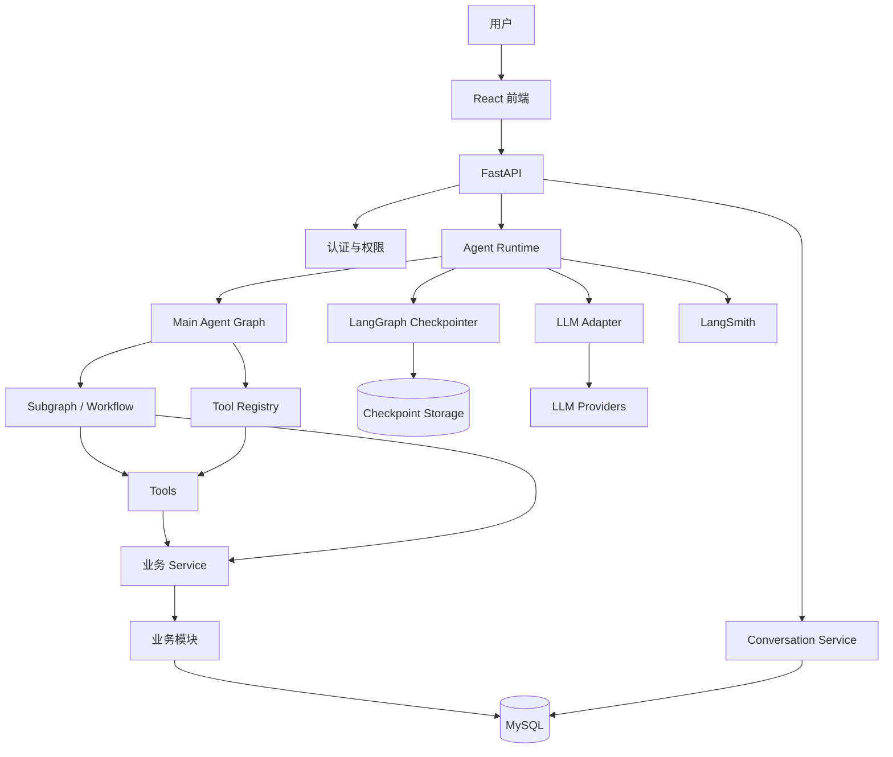
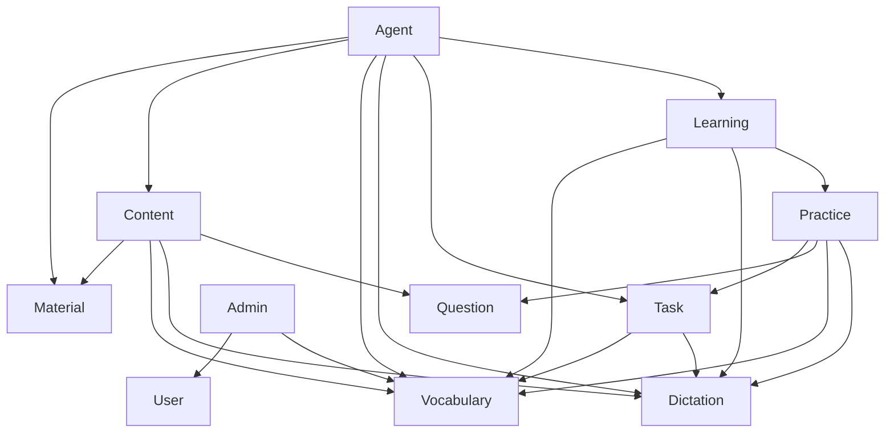
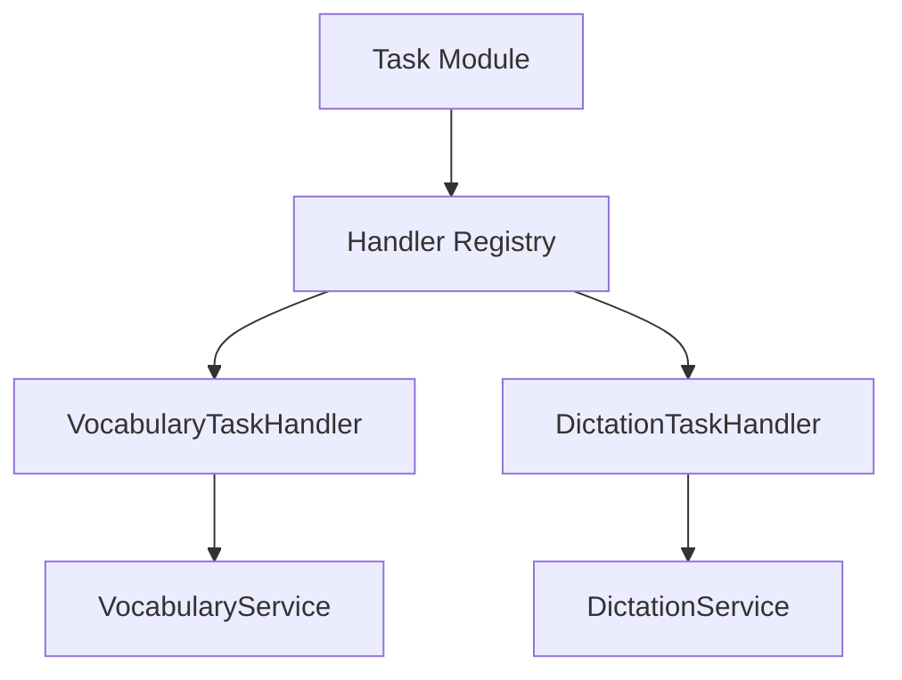
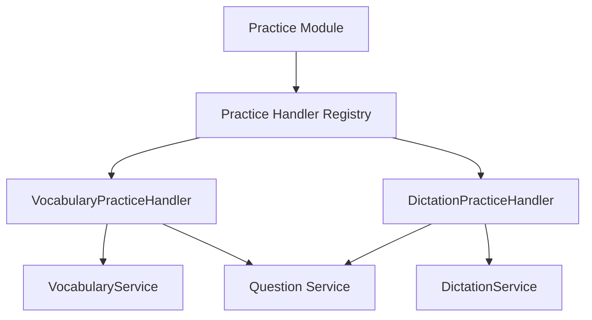
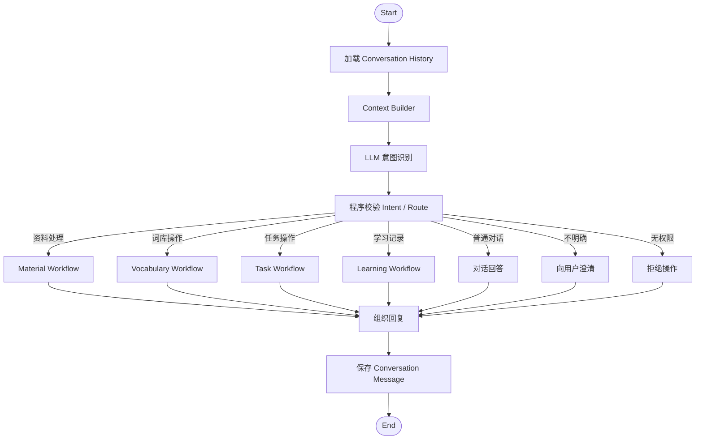
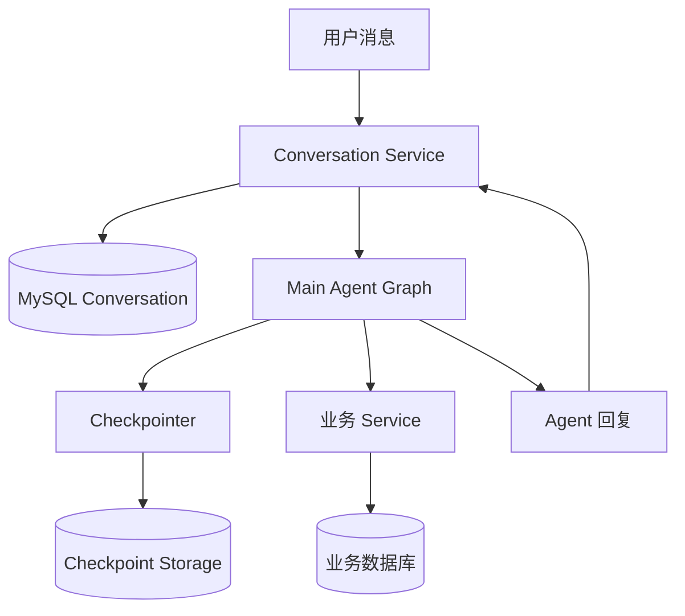
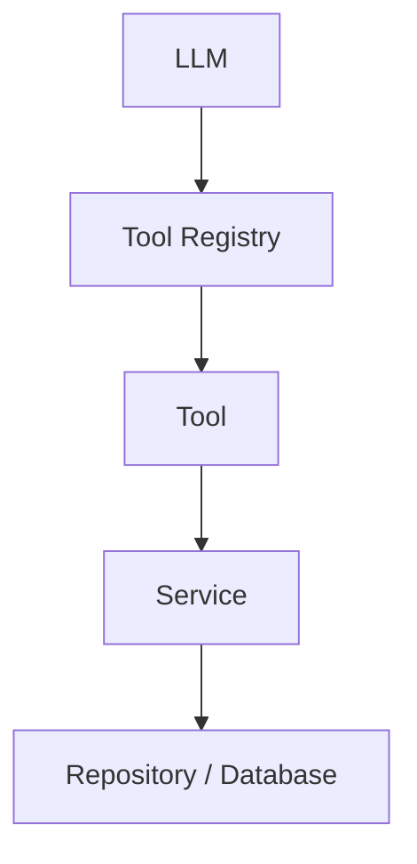

# 家庭学习助手系统架构与开发设计文档

**版本：** V1.0  
**状态：** 架构决策已确认，进入开发设计阶段  
**技术栈：** Python + FastAPI + LangGraph + React + TypeScript + MySQL

---

# 1. 项目概述

## 1.1 产品定位

本项目定位为 AI 学习助手（AI Learning Assistant）。

用户通过自然语言与 Agent 对话，完成学习资料处理、词库创建、学习任务创建和管理、学习记录查询等操作。

Agent 负责理解用户意图、组织工作流程、调用工具和反馈结果。

实际学习过程不在聊天窗口中完成，而是在独立的学习页面中执行。

系统不是传统的固定课程平台，而是以 Agent 为统一入口，由 Agent 帮助用户组织和管理学习内容。

## 1.2 MVP 功能范围

第一版本只实现两种学习类型：

1. Vocabulary：词汇学习。
2. Dictation：听写。

架构预留后续增加其他学习类型的能力，但不提前实现通用学习类型接口。

核心功能：

- 用户注册、登录和个人数据管理。
- Agent 对话和历史记录。
- 学习资料上传、解析和内容提取。
- 个人词库创建、导入、编辑和删除。
- 管理员公共词库管理。
- 通过对话创建、修改和删除学习任务。
- 学习任务列表和详情。
- 词汇练习和听写练习。
- 学习记录、错题和掌握情况。
- 管理员用户管理和公共资源管理。
- Agent 执行过程展示和运行监控。

## 1.3 产品交互原则

系统分为两个主要交互区域：

**Agent 对话区域**

负责：
- 理解用户需求。
- 处理上传的学习资料。
- 创建词库。
- 创建和修改学习任务。
- 查询学习记录。
- 执行需要多步骤协作的操作。

**业务操作区域**

负责：
- 查看和管理词库。
- 查看和管理学习任务。
- 执行学习任务。
- 查看学习记录。
- 查看错题和掌握情况。

对话和业务页面调用同一套 Service，不允许分别实现业务逻辑。

---

# 2. 总体技术架构

## 2.1 技术选型

| 层次 | 技术 | 说明 |
|---|---|---|
| 前端 | React + TypeScript | 前后端分离 |
| 后端 | Python + FastAPI | HTTP API 和 SSE |
| Agent | LangGraph | Agent 编排和工作流 |
| LLM | 统一 LLM Adapter | 支持多个模型供应商 |
| Prompt | 项目文件 + Git | MVP 不提供 Prompt 管理后台 |
| 关系数据库 | MySQL | 正式业务数据 |
| 本地开发数据库 | SQLite | 允许本地开发使用 |
| Graph 状态 | LangGraph Checkpointer | 持久化 Workflow 状态 |
| Agent 监控 | LangSmith | Graph、LLM、Tool 调用追踪 |
| 文件存储 | 文件存储抽象 | 数据库只保存文件元数据和位置 |

模型供应商、模型名称、API 参数应当可以通过配置调整。

不同 Graph 节点可以使用不同模型，但模型选择由程序配置控制，不能让 LLM 自行切换模型。

## 2.2 总体架构图



## 2.3 核心架构原则

1. Agent 不直接操作数据库。
2. Agent 不直接实现业务规则。
3. 所有业务操作必须通过 Service。
4. 前端页面和 Agent 调用相同的 Service。
5. 每个业务模块拥有自己的数据。
6. 跨模块访问通过公开接口完成。
7. LLM 负责理解和生成，程序负责验证和执行。
8. 所有重要写操作必须经过程序验证和用户确认。
9. Agent 的权限由后端可信上下文和 Tool Registry 控制。
10. LangGraph Checkpoint 不作为业务数据存储。

---

# 3. 业务模块划分

## 3.1 模块清单

| 模块 | 主要职责 | 数据归属 |
|---|---|---|
| Agent | 对话理解、Graph 编排、Tool 调用 | Agent 运行状态 |
| Material | 原始文件、文件元数据 | 文件元数据 |
| Content | 通用内容解析和加工 | 临时加工状态 |
| Vocabulary | 词库、词条、词义、词汇掌握情况 | 词汇业务数据 |
| Dictation | 听写相关业务规则和数据 | 听写业务数据 |
| Question | 题目生成、存储和通用校验 | 题目数据 |
| Task | 学习任务管理和学习类型路由 | 任务数据 |
| Practice | 练习生命周期和答题记录 | 练习数据 |
| Learning | 学习统计、错题汇总和复习计划 | 学习分析数据 |
| User | 用户、登录、账户设置 | 用户数据 |
| Admin | 管理员功能和公共资源管理 | 管理操作记录 |

## 3.2 模块依赖关系



图中的箭头代表逻辑调用方向，不代表允许直接访问对方数据库。

具体规则：

- Agent 只能通过公开 Service 或 Tool 访问业务模块。
- Content 可以调用业务模块的正式保存接口，但不能直接写入其数据库。
- Task 通过学习类型 Handler 调用 Vocabulary 或 Dictation。
- Practice 通过学习类型 Practice Handler 调用具体学习模块。
- Learning 通过公开接口获取学习数据，不直接访问其他模块的数据表。
- Admin 通过公开管理接口完成用户和公共资源管理。

## 3.3 禁止事项

以下行为禁止出现：

1. 一个模块直接访问另一个模块的 Repository。
2. 一个模块直接操作另一个模块的数据表。
3. Agent 绕过 Service 写数据库。
4. 前端页面自行实现一套业务规则。
5. Tool 内部重复实现 Service 已有的业务规则。
6. Question 模块直接读取 Vocabulary 或 Dictation 数据库。
7. Task 模块直接实现词汇掌握或听写判断逻辑。
8. Learning 模块直接修改 Practice 的答题记录。
9. 为了方便开发，把所有业务逻辑放进 Agent 或公共 Utils。
10. 将 LangChain/LangGraph 内部对象直接作为产品数据库的数据结构。

---

# 4. Task 与学习类型的隔离设计

## 4.1 设计原则

Task 是统一的学习任务管理模块，但不负责具体学习类型的业务规则。

Vocabulary 和 Dictation 独立实现。

当前不提前抽象统一学习类型接口，只在 Task 和 Practice 两个模块中使用 Handler 适配机制。

当未来出现第三种学习类型时，再根据真实需求提取公共能力。

## 4.2 Task Handler



Handler 负责：

- 识别任务所属学习类型。
- 将统一任务请求转换为具体学习模块需要的参数。
- 调用对应 Service。
- 将结果转换为 Task 可以理解的统一结果。

Handler 不负责：

- 复制学习模块的业务规则。
- 直接访问学习模块数据库。
- 自行计算词汇掌握情况。
- 自行实现听写判定逻辑。

## 4.3 Practice Handler



Practice 负责：

- 开始练习。
- 恢复练习。
- 保存答题进度。
- 提交练习。
- 完成练习。
- 保存每道题的答案和正确性。
- 管理练习生命周期。

具体学习类型 Handler 负责：

- 生成当前练习内容。
- 处理类型相关的交互。
- 调用对应学习模块完成答案检查。
- 返回统一的练习结果。

---

# 5. Agent 内部架构

## 5.1 Agent 组织方式

采用：

**Single Agent + Internal Subgraphs**

系统只有一个统一 Agent。

复杂业务流程通过 LangGraph Subgraph 实现。

Subgraph 不一定是独立 Agent，可以是由普通程序节点组成的 StateGraph，只有真正需要 LLM 判断的地方才调用 LLM。

## 5.2 Main Agent 架构



## 5.3 主路由原则

LLM 负责：

- 理解用户意图。
- 提取必要参数。
- 输出结构化 Intent 和 Route。
- 在需要时选择可用 Tool。

程序负责：

- 校验 Workflow 是否存在。
- 校验用户权限。
- 校验必要参数。
- 校验业务状态。
- 决定是否允许进入 Workflow。
- 决定是否需要用户确认。

不能仅依靠 LLM 的置信度决定是否执行操作。

## 5.4 Subgraph 划分

按照复杂业务流程划分，而不是按照业务模块一一对应。

MVP 规划：

| Workflow | 主要职责 |
|---|---|
| Material Workflow | 上传、解析、提取、预览和确认 |
| Vocabulary Workflow | 创建、导入、编辑词库 |
| Task Workflow | 创建、修改和删除任务 |
| Learning Workflow | 查询学习记录、错题和复习信息 |

简单操作可以由 Main Agent 直接调用 Tool，不需要为了每个业务操作都创建 Subgraph。

---

# 6. Graph State 设计

## 6.1 MainAgentState

主 Graph 只保存运行时上下文，不保存完整业务对象。

建议结构：

```python
class MainAgentState(TypedDict):
    messages: list
    intent: dict | None
    route: str | None
    active_workflow: str | None
    execution_status: str
    response: str | None
    pending_action: dict | None
```

实际实现中需要使用明确的类型定义，不能使用大量无约束的 Any。

`messages` 可以使用 LangGraph/LangChain 消息对象作为运行时结构，但不能直接将这些对象作为产品数据库的消息 Schema。

## 6.2 Subgraph State

每个 Subgraph 使用独立 State。

例如 Task Workflow：

```python
class TaskWorkflowState(TypedDict):
    operation: str
    task_type: str | None
    task_id: str | None
    extracted_config: dict
    missing_fields: list
    preview: dict | None
    action_id: str | None
    confirmed: bool
    result: dict | None
```

Subgraph 通过明确的输入和输出契约与 Main Agent 交互。

禁止直接读取和修改父 Graph 的 State。

## 6.3 Runtime Context

可信运行上下文由后端认证层注入。

```python
class RuntimeContext:
    user_id: str
    conversation_id: str
    trace_id: str
```

规则：

- `user_id` 只能来自后端认证结果。
- LLM 不得决定或覆盖 `user_id`。
- Tool 不得信任模型传入的用户身份。
- 业务 ID 可以作为明确参数传入 State。
- Runtime Context 和业务 State 分开管理。

## 6.4 Checkpoint

使用 LangGraph 标准 Checkpointer。

生产环境需要持久化，开发环境允许 SQLite。

Checkpointer 负责：

- 保存 Graph State。
- 保存当前执行位置。
- 保存 Interrupt 状态。
- 支持 Workflow 恢复。
- 支持服务重启后的状态恢复。

Checkpoint 不保存正式业务数据，不代替 Conversation。

生产环境的 MySQL Checkpointer 适配方案需要在编码前验证实际兼容性。如果标准 Checkpointer 没有可用的 MySQL 实现，不得自行伪造一个兼容层；应先解决持久化适配方案，再进入相关开发。

---

# 7. Conversation 设计

## 7.1 存储原则

Conversation 和 Checkpoint 分开存储。

Conversation 使用 MySQL。

Checkpoint 使用 LangGraph Checkpointer。

业务数据由各自业务模块存储。

三者互不替代。

## 7.2 Conversation 数据结构

### conversation

| 字段 | 说明 |
|---|---|
| id | Conversation ID |
| user_id | 所属用户 |
| title | 会话标题 |
| status | 会话状态 |
| created_at | 创建时间 |
| updated_at | 更新时间 |

### conversation_message

| 字段 | 说明 |
|---|---|
| id | 消息 ID |
| conversation_id | 所属会话 |
| message_type | 消息类型 |
| content | JSON 内容 |
| tool_call_id | Tool 调用关联 ID |
| created_at | 创建时间 |

消息类型：

- `user`
- `assistant`
- `tool_call`
- `tool_result`
- `system`（按需要使用）

Tool 调用和 Tool 结果分别保存为独立消息，并通过 `tool_call_id` 关联。

消息内容使用结构化 JSON，普通文本只是其中一种内容形式。

不直接持久化 LangChain/LangGraph 原始 Message 对象。

## 7.3 Conversation 与 Checkpoint 的关系



职责：

| 数据 | 存储位置 |
|---|---|
| 用户消息 | Conversation |
| Agent 回复 | Conversation |
| Tool 调用记录 | Conversation |
| Tool 执行结果 | Conversation |
| Graph 执行 State | Checkpoint |
| 任务、词库和练习数据 | 业务数据库 |

Conversation 是产品级对话历史。

Checkpoint 是 Graph 运行时恢复数据。

即使 Checkpoint 被清理，Conversation 和业务数据也不能受到影响。

## 7.4 Conversation 历史

MVP 使用单一长期 Conversation，不支持多个独立 Conversation。

每次 LLM 调用通过 Context Builder 获取完整历史。

如果超过模型上下文窗口：

- 保留最近消息。
- 保留当前 Workflow 必要上下文。
- 不在 MVP 中实现自动摘要和历史检索。

---

# 8. Tool 设计

## 8.1 Tool 的定位

Tool 是 Agent 可以动态选择的业务能力适配器。

固定业务步骤由 Workflow Node 直接调用 Service。

需要 LLM 动态选择的操作才注册为 Tool。

Tool 不负责复杂业务流程编排。

Tool 不能直接调用其他 Tool。

复杂操作由 Workflow 组织，底层 Service 可以被重复使用。

## 8.2 Tool 注册

Tool Registry 统一管理：

- Tool 名称。
- Tool 描述。
- 输入 Schema。
- 权限声明。
- 实现函数。
- 返回结构。

示例：

```python
ToolDefinition(
    name="task.create",
    description="创建学习任务",
    required_permissions=["task:create"],
    input_schema=CreateTaskInput,
    handler=create_task,
)
```

每个 Tool 使用 Pydantic Schema 定义：

- 参数类型。
- 必填字段。
- 参数范围。
- 字段说明。
- 结构约束。

Schema 可以与 API 共用，但不强制所有场景共用同一个 Schema。

## 8.3 Tool 权限

采用两层权限控制。

第一层：Tool Registry。

根据当前用户的权限过滤可用 Tool，避免将用户无权使用的能力暴露给 LLM。

第二层：Service。

Service 必须重新检查：

- 当前用户身份。
- 用户角色。
- 资源归属。
- 业务状态。
- 操作权限。

Registry 过滤不能代替 Service 权限校验。

## 8.4 Tool 返回结构

统一返回：

```python
class ToolResult(BaseModel):
    success: bool
    data: dict | None = None
    error_code: str | None = None
    message: str | None = None
    hint: str | None = None
```

实际代码可以根据需要使用泛型结果类型。

错误分类至少包括：

- parameter_error
- permission_error
- business_error
- transient_system_error
- unrecoverable_error

同时保留具体业务错误码。

不能把 Python Exception、数据库异常和堆栈直接返回给 LLM。

## 8.5 Tool 与 Service 的关系



Tool 负责参数校验和适配。

Service 负责权限、业务规则、事务和状态转换。

Repository 负责数据持久化。

---

# 9. 用户确认与重要操作

## 9.1 创建操作

创建任务、词库等重要对象时：

1. Agent 理解用户需求。
2. 提取配置。
3. 程序补全能够推断的信息。
4. 缺少必要信息时询问用户。
5. 展示完整配置预览。
6. 用户确认。
7. Service 执行创建。
8. Agent 返回结果。

未确认之前不得产生业务写操作。

## 9.2 action_id

每次生成预览时创建唯一 `action_id`。

确认请求必须携带该 ID。

后端同时验证配置 Hash，确保用户确认的是当前展示的配置。

用户修改配置后：

- 更新配置。
- 重新展示完整预览。
- 生成新的 action_id。
- 旧确认失效。

## 9.3 删除操作

删除使用两阶段确认：

第一阶段：

- 用户提出删除。
- Agent 展示目标和影响。
- 用户第一次确认。

第二阶段：

- Agent 再次明确展示删除对象和后果。
- 用户进行第二次明确确认。
- Service 执行删除。

## 9.4 Pending Action

MVP 不建立独立 PendingAction 数据表。

待确认操作存储在 LangGraph State 和 Checkpoint 中。

不设置固定过期时间，直到：

- 用户确认。
- 用户取消。
- Workflow 被清理。

## 9.5 幂等

`action_id` 用作确认操作的幂等标识。

Service 必须保证同一操作不会因重复请求而重复执行。

需要明确：

- 同一确认请求的重试复用相同 action_id。
- 新预览必须生成新的 action_id。
- 已经执行成功的 action_id 再次提交时，应返回原操作结果或明确的已执行结果。
- 不能只依靠前端按钮禁用实现幂等。

---

# 10. Workflow 管理

## 10.1 单活动 Workflow

一个 Conversation 同一时间最多有一个活动 Workflow。

不支持多个并行挂起 Workflow。

同一 Conversation 的 Graph 请求串行执行。

## 10.2 无关问题

当 Workflow 等待确认时，如果用户提出无关问题：

1. 暂时挂起当前 Workflow。
2. 处理无关问题。
3. 保留原有 Pending Action。
4. 回到原 Workflow 等待确认。

不能因为用户提出一个普通问题，就自动取消原有操作。

## 10.3 用户主动放弃

如果用户明确表示放弃：

- 取消当前 Workflow。
- 清除 Pending Action。
- 保留 Conversation 历史。

## 10.4 中断和恢复

使用 LangGraph：

- `interrupt()`：进入等待确认状态。
- `Command(resume=...)`：恢复执行。
- 稳定的 `thread_id`：定位同一 Graph 执行线程。

注意：LangGraph 恢复时可能重新执行 Interrupt 之前的代码。

因此：

- Interrupt 之前不能提前执行不可逆业务写操作。
- Service 必须具备幂等能力。
- 不能假设代码只执行一次。

---

# 11. Agent Prompt 与 Context

## 11.1 Prompt 管理

Main Agent 和不同 Subgraph 使用独立 Prompt。

可以抽取公共 Prompt 片段。

MVP Prompt 以项目文件形式管理，按模块组织，纳入 Git。

不建设数据库 Prompt 管理后台。

每次执行记录：

- Prompt 版本。
- Git Commit ID 或其他可追踪版本标识。
- 使用的模型和参数。

## 11.2 LLM Adapter

所有 LLM 调用通过统一 Adapter。

负责：

- Provider 适配。
- 模型选择。
- 参数配置。
- 超时。
- 重试。
- 统一异常处理。
- Token 使用统计。

不同节点可以使用不同模型，但模型由程序配置决定。

## 11.3 Context Builder

统一 Context Builder 负责组装：

- Conversation 历史。
- 用户基本信息。
- 当前 Workflow 上下文。
- 当前任务或词库必要信息。
- 当前操作需要的业务数据。
- Prompt。

不要让每个 Graph Node 各自拼装一套上下文。

---

# 12. 运行时与前后端通信

## 12.1 通信方式

采用 HTTP API + SSE。

HTTP 负责发起请求。

SSE 负责返回：

- Agent 回复。
- 执行进度。
- Tool 状态。
- 确认请求。
- 错误。
- 完成事件。

MVP 不使用 WebSocket。

## 12.2 SSE 统一事件

统一事件格式：

```json
{
  "event_id": "event-001",
  "conversation_id": "conversation-001",
  "type": "progress",
  "timestamp": "2026-11-02T10:00:00+08:00",
  "data": {
    "stage": "parsing_material",
    "status": "running",
    "message": "正在解析学习资料"
  }
}
```

事件类型：

| 类型 | 说明 |
|---|---|
| message | Agent 回复内容 |
| progress | 业务进度 |
| tool_status | Tool 执行状态 |
| confirmation_required | 等待用户确认 |
| error | 执行失败 |
| done | 当前请求结束 |

事件格式由后端统一维护。

不能将 LangGraph 原始事件直接透传给前端。

## 12.3 Agent 执行状态

程序维护明确的运行状态：

- idle
- thinking
- executing
- waiting_confirmation
- completed
- failed
- cancelled

状态转换由后端控制。

前端只负责展示，不自行推断业务状态。

## 12.4 SSE 断开

SSE 断开不主动取消 Graph。

Graph 执行与浏览器连接生命周期分离。

用户重新连接时：

1. 查询 Conversation。
2. 查询当前 Workflow 状态。
3. 查询最近执行事件或结果。
4. 根据实际状态决定是否继续接收或恢复执行。

不能只依靠原来的 SSE 连接保存执行状态。

## 12.5 服务重启

服务重启后：

- Checkpoint 保留未完成 Workflow。
- Conversation 保留历史消息。
- 用户重新进入 Conversation 后查询运行状态。
- 后端根据 Checkpoint 判断是否可以恢复。

这里需要特别明确：Checkpointer 只负责保存恢复状态，不会自动启动一个已经中断的 Python Graph 执行。

恢复必须由后续请求或明确的恢复入口触发。

## 12.6 同步执行约束

MVP 不引入 Async Job、Worker、消息队列和独立 Job 状态表。

所有业务操作同步执行。

需要设置：

- HTTP 请求超时。
- LLM 请求超时。
- Tool 执行超时。
- 文件大小限制。
- 批量处理数量限制。
- Graph 最大执行时间。

SSE 用于同步请求执行过程中的消息和进度输出。

如果未来发现某些操作明显超出同步请求适用范围，再独立设计异步 Job。

## 12.7 同一 Conversation 并发

同一 Conversation 同时只允许一个 Graph 执行。

必须在后端实施并发控制，不能依赖前端按钮禁用。

并发锁需要支持超时和异常释放，避免进程异常后永久锁定。

---

# 13. 运行详情展示与安全

## 13.1 执行详情

前端支持两个视图：

**普通对话视图**

展示：
- 用户消息。
- Agent 回复。
- 操作结果。
- 学习任务创建结果。

**执行详情视图**

根据已确认的 8.7 决策，完整展示：

- Graph 节点。
- Tool 调用。
- Tool 参数。
- Tool 返回结果。
- 执行耗时。
- 错误信息。
- 执行状态。

## 13.2 安全要求

完整展示不等于原样暴露所有内部信息。

必须脱敏：

- API Key。
- Access Token。
- Cookie。
- 密码。
- 内部认证凭据。
- 不应向用户暴露的敏感个人数据。

Prompt 可以作为受控调试信息展示，但不能包含密钥和敏感配置。

执行详情只能查看当前用户有权限查看的 Conversation 和操作。

管理员是否可以查看用户执行详情，遵循管理员的数据查看权限。

---

# 14. 错误处理与运行限制

## 14.1 错误处理原则

Tool 和 Service 负责：

- 参数验证。
- 权限检查。
- 错误分类。
- 安全重试。
- 返回结构化错误。

Agent 负责：

- 根据错误决定是否调整参数。
- 是否选择其他方案。
- 是否询问用户。
- 是否解释失败原因。

## 14.2 重试规则

- LLM 调用失败：程序负责有限次重试。
- Tool 执行失败：Tool 或 Service 根据错误类型处理。
- 瞬时错误：允许安全重试。
- 业务错误：不应盲目重试。
- 不可恢复错误：停止并反馈。

具有副作用的操作必须具备幂等机制。

不能对创建、删除等操作简单地无限重试。

## 14.3 循环和资源限制

程序必须限制：

- Graph 最大步骤数。
- Tool 最大调用次数。
- LLM 最大调用次数。
- 单次执行最长时间。
- Token 使用量。

LangGraph `recursion_limit` 只是额外保护，不能作为唯一限制。

达到限制后停止执行或转为人工处理。

---

# 15. 监控与日志

## 15.1 LangSmith

LangSmith 负责：

- Graph 节点追踪。
- LLM 请求和响应追踪。
- Token 使用量。
- Tool 调用。
- 节点耗时。
- 错误定位。

## 15.2 业务操作日志

独立记录重要业务操作。

例如：

- 创建词库。
- 修改词库。
- 删除词库。
- 创建任务。
- 修改任务。
- 删除任务。
- 管理员重置密码。
- 管理员发布公共词库。

## 15.3 关联标识

使用以下标识关联数据：

| 标识 | 职责 |
|---|---|
| conversation_id | 产品对话 |
| thread_id | LangGraph 执行线程 |
| trace_id | 一次 Agent 执行追踪 |
| operation_id | 一次业务操作 |

各自独立，不要强制全部使用同一个 ID。

---

# 16. Question 模块设计

## 16.1 模块定位

Question 负责：

- 题目生成。
- 题目存储。
- 通用结构校验。
- 答案格式校验。
- 根据结构化规则配置执行通用答案规则。

Vocabulary 和 Dictation 提供领域数据和规则配置。

Question 不直接访问其他学习模块数据库。

## 16.2 规则配置

采用结构化规则配置，不采用回调函数模式。

Question 定义支持的题型和规则类型。

学习模块提供规则配置。

Question 根据配置执行。

领域业务校验仍然由对应学习模块负责。

## 16.3 题目存储

采用统一 Question 主表 + JSON 扩展字段。

主表保存通用字段。

扩展 JSON 保存题型特有字段。

不能因为使用统一表，就把所有领域规则塞进 Question 模块。

---

# 17. Task 与 Practice 业务规则

## 17.1 Task 规则

1. 固定任务：所有内容至少练习一次即可完成。
2. 长期任务：所有词汇内容完成学习后任务完成。
3. 一个任务可以重复练习。
4. 每次练习创建独立 Attempt。
5. 重复练习相同内容不重复增加任务完成进度。
6. 固定任务创建后不能修改学习内容。
7. 修改固定任务内容需要删除并重新创建。
8. 长期任务使用创建时的词库快照。
9. 后续修改词库不影响已有任务。
10. 长期任务修改分组规则时，从下一组开始生效，当前组使用旧规则。
11. 删除任务时，同时删除其历史练习记录。
12. 任务只有 `in_progress` 和 `completed` 两种状态，不设置 paused。

## 17.2 Task 内容快照

任务创建时必须保存内容快照。

长期任务需要保存完整词库快照或可独立恢复的版本引用。

不能仅保存原始词库 ID，然后在练习时读取最新词库。

## 17.3 Practice 规则

每次练习保存：

- 练习任务。
- 练习开始和结束时间。
- 每道题的答案。
- 每道题是否正确。
- 每道题的答题时间。
- 练习状态和进度。

中断时自动保存进度。

再次进入时恢复未完成练习。

练习记录不能单独删除，只能随任务删除。

第一版本保存词条学习历史，但不建设单词独立历史详情页面。

## 17.4 任务进度

采用模块独立计算：

- Vocabulary 负责词汇掌握情况。
- Dictation 负责听写相关学习状态。
- Task Handler 负责当前任务进度计算。
- Learning 负责汇总学习统计。
- Task 保存统一任务状态和进度结果。

任务进度在练习提交或完成后计算并持久化。

练习记录是事实数据，任务进度是可重新计算的派生数据。

需要保证练习记录保存和进度更新的一致性，并提供重新计算能力。

---

# 18. Vocabulary 业务规则

1. 同一个词库中不能有重复词条。
2. 一个词条允许保存多个词义。
3. 个人词库支持批量编辑和删除。
4. MVP 不提供 Excel 导出。
5. 用户不能将个人词库发布为公共词库。
6. 个人词库即使被任务引用，也允许删除。
7. 已有任务不受词库后续修改影响。
8. 分类采用预设分类 + 自定义标签。
9. 公共词库复制到个人词库后生成独立数据。
10. 公共词库后续更新不影响个人副本。

词汇掌握状态：

- 根据答题数据计算。
- 用户不能手动修改掌握状态。
- 连续答对达到配置阈值后标记为已掌握。
- 答错后仍进入后续复习。
- 错题重做正确后仍然可能进入后续复习。

连续正确阈值和自动复习间隔算法尚未最终确定，应配置化，不要在代码中散落固定数字。

---

# 19. 错题和复习

支持：

- 从任务创建错题练习。
- 从词库错题池创建独立练习。
- 错题重做。
- 自动复习计划。
- 根据答题表现动态调整复习时间。
- 每次错题重做创建独立练习记录。

错题重做规则：

- 对于配置了强制重做的长期任务或分组，答对后才能进入下一组。
- 答错记录保留。
- 重做正确后仍然进入后续复习。

注意：强制重做是特定任务或分组的执行约束，不代表所有固定任务都必须答对才能完成。

---

# 20. Material 与 Content

## 20.1 Material

Material 负责原始文件管理：

- 文件上传。
- 文件元数据。
- 文件类型。
- 文件大小。
- 文件存储位置。
- 文件访问权限。

MySQL 只保存图片等文件的元数据和文件位置，不直接将大文件内容存入业务表。

## 20.2 Content

Content 是通用内容加工流程，不是正式业务内容的所有者。

负责：

- 文件解析。
- OCR。
- 文本提取。
- 内容整理。
- 分阶段生成。
- 结果预览。
- 用户确认。
- 将确认后的内容提交给对应业务模块。

Content 不负责正式保存 Vocabulary 或 Dictation 领域数据。

正式数据必须通过相应业务模块的 Service 保存。

## 20.3 分阶段生成

内容加工必须分阶段。

每个阶段展示结果，并由用户确认后再进入下一阶段。

不要一次性要求模型生成所有内容。

---

# 21. 用户与管理员权限

## 21.1 用户登录

采用昵称 + 密码登录。

普通用户默认没有管理员权限。

管理员权限由后端分配。

昵称全局唯一。

用户可以修改昵称。

## 21.2 用户数据隔离

用户个人数据完全隔离。

公共词库等公共资源允许共享。

所有查询和写操作都必须验证数据归属。

## 21.3 管理员权限

管理员可以：

- 查看所有用户的数据。
- 查看详细学习记录和答题记录。
- 管理用户账户。
- 重置用户密码。
- 管理公共词库。
- 创建、编辑、删除和发布公共词库。
- 查看关键操作日志。

管理员不能：

- 代替用户创建学习任务。
- 代替用户修改学习任务。
- 代替用户删除学习任务。
- 修改用户答题结果。
- 修改用户词汇掌握结果。

管理员可以查看，不代表可以代替用户执行业务操作。

---

# 22. Agent 测试体系

## 22.1 测试原则

Mock LLM 作为自动化回归测试的主要方式。

真实 LLM 用于周期性评估。

不能依赖真实模型的不确定输出作为所有自动化测试的判断依据。

## 22.2 Graph 测试

Mock LLM，提供固定结构化输出。

测试：

- 节点执行。
- 分支判断。
- Workflow 路由。
- Tool 调用。
- 参数传递。
- 确认机制。
- 错误分支。
- 执行限制。

## 22.3 Tool 测试

独立测试：

- 参数校验。
- 权限过滤。
- Service 调用。
- 错误分类。
- 重试机制。
- 幂等性。

## 22.4 Checkpoint 测试

测试：

- Interrupt。
- Resume。
- 重复 Resume。
- 服务重启后恢复。
- 确认幂等。
- Checkpoint 清理。

## 22.5 真实 LLM 评估

建立固定测试集。

评估：

- 意图识别。
- 参数提取。
- Tool 选择。
- 结构化输出。
- 模糊请求处理。

允许模型结果存在一定非确定性，使用评估指标判断，不强求每次输出完全一致。

## 22.6 E2E 测试

关键场景必须有硬性断言：

- 创建任务前必须经过确认。
- 未确认不能产生业务写操作。
- 用户不能操作其他用户的数据。
- 管理员不能修改用户学习结果。
- 任务内容快照不受原词库后续修改影响。
- 重复确认不能重复创建。
- 中断练习可以恢复。
- 删除任务时按规则删除相关记录。

---

# 23. API 与前端设计原则

## 23.1 API 基本原则

前后端通过 HTTP API 交互。

Agent 对话使用 SSE。

普通业务页面使用标准 HTTP API。

所有 API 必须经过认证和权限检查。

## 23.2 API 设计范围

需要实现以下接口组：

| 接口组 | 主要功能 |
|---|---|
| Auth API | 注册、登录、退出、修改密码 |
| Conversation API | 查询会话、历史消息、发送消息 |
| Agent API | 发起 Agent 执行、确认、取消 |
| Material API | 上传文件、查询文件 |
| Vocabulary API | 词库管理、词条管理 |
| Dictation API | 听写相关管理 |
| Task API | 任务列表、详情、修改、删除 |
| Practice API | 开始、恢复、提交、完成练习 |
| Learning API | 学习统计、错题、复习计划 |
| Admin API | 用户和公共词库管理 |

具体请求和响应 Schema 在 API 设计阶段逐项确定。

## 23.3 前端页面

MVP 页面建议：

1. 登录页面。
2. Agent 对话首页。
3. 任务列表。
4. 任务详情。
5. 词库列表。
6. 词库详情。
7. 练习页面。
8. 学习记录页面。
9. 管理后台。

首页以 Agent 对话为核心。

侧边导航提供任务、词库和学习记录入口。

任务列表只展示：

- 任务名称。
- 任务状态。
- 学习进度。

详细信息在任务详情页面查看。

任务修改既可以通过 Agent，也可以通过任务详情页面完成。

两者最终调用同一个 Task Service。

---

# 24. 开发目录结构建议

建议采用模块化 Python 后端，不把所有代码堆放在一个目录。

```text
backend/
├── app/
│   ├── main.py
│   ├── api/
│   │   ├── routes/
│   │   ├── schemas/
│   │   └── dependencies/
│   │
│   ├── core/
│   │   ├── config.py
│   │   ├── database.py
│   │   ├── security.py
│   │   ├── exceptions.py
│   │   └── runtime_context.py
│   │
│   ├── modules/
│   │   ├── agent/
│   │   │   ├── graphs/
│   │   │   ├── workflows/
│   │   │   ├── states/
│   │   │   ├── tools/
│   │   │   ├── registry/
│   │   │   ├── prompts/
│   │   │   ├── context/
│   │   │   ├── runtime/
│   │   │   └── services/
│   │   │
│   │   ├── material/
│   │   ├── content/
│   │   ├── vocabulary/
│   │   ├── dictation/
│   │   ├── question/
│   │   ├── task/
│   │   ├── practice/
│   │   ├── learning/
│   │   ├── user/
│   │   └── admin/
│   │
│   ├── infrastructure/
│   │   ├── llm/
│   │   ├── storage/
│   │   ├── checkpoint/
│   │   ├── tracing/
│   │   └── persistence/
│   │
│   └── tests/
│       ├── unit/
│       ├── integration/
│       ├── graph/
│       └── e2e/
│
├── migrations/
├── scripts/
├── requirements.txt
└── README.md

frontend/
├── src/
│   ├── api/
│   ├── components/
│   ├── layouts/
│   ├── pages/
│   ├── features/
│   │   ├── conversation/
│   │   ├── task/
│   │   ├── vocabulary/
│   │   ├── dictation/
│   │   ├── practice/
│   │   └── learning/
│   ├── hooks/
│   ├── stores/
│   └── types/
└── package.json
```

以上是建议目录，实际开发可以根据代码规模微调，但不能因此破坏模块边界。

---

# 25. 开发阶段与验收顺序

不要一次性生成全部代码。

按下面顺序逐步开发，每个阶段完成后进行测试和验收。

## 阶段一：项目基础设施

完成：

- 前后端项目初始化。
- FastAPI 基础结构。
- React 基础结构。
- 配置管理。
- 数据库连接。
- 数据库迁移。
- 用户注册和登录。
- 权限基础设施。
- 统一异常处理。
- 日志基础设施。

验收：

- 用户可以注册和登录。
- 用户数据可以正确隔离。
- 本地 SQLite 可以运行。
- 生产 MySQL 配置可用。

## 阶段二：Conversation 和 Agent Runtime

完成：

- Conversation 表和 Message 表。
- Conversation Service。
- Main Agent Graph。
- MainAgentState。
- Runtime Context。
- LLM Adapter。
- Prompt 管理。
- Context Builder。
- Checkpoint。
- SSE 通信。
- 执行状态管理。

验收：

- 可以通过对话调用 Agent。
- 消息可以持久化。
- 刷新页面后可以查看历史消息。
- Graph 可以中断和恢复。
- SSE 可以返回消息和进度。
- 不同用户之间的会话隔离。

## 阶段三：Tool Registry 和权限

完成：

- Tool Definition。
- Pydantic Schema。
- Tool Registry。
- 权限过滤。
- Tool 统一返回结构。
- 错误分类。
- 幂等机制。
- Service 权限二次检查。

验收：

- 普通用户不能调用管理员 Tool。
- LLM 不能伪造 user_id。
- 用户不能操作其他用户的数据。
- 重复操作不会产生重复业务写入。

## 阶段四：Material 和 Content

完成：

- 文件上传。
- 文件元数据管理。
- 文件存储抽象。
- 文件解析。
- OCR 接口。
- 内容提取。
- 内容预览。
- 分阶段确认。

验收：

- 用户可以上传学习资料。
- 系统可以展示解析结果。
- 未确认前不保存正式业务数据。
- 文件访问经过用户权限检查。

## 阶段五：Vocabulary 和 Question

完成：

- 个人词库。
- 公共词库。
- 词条和词义。
- 批量导入。
- 词库复制。
- Question 统一数据模型。
- 题目生成。
- 题目结构校验。

验收：

- 用户可以创建和编辑个人词库。
- 管理员可以管理公共词库。
- 公共词库复制后相互独立。
- Question 不直接访问 Vocabulary 数据库。

## 阶段六：Task

完成：

- Task 数据模型。
- Task Service。
- Task Handler Registry。
- VocabularyTaskHandler。
- DictationTaskHandler。
- 任务快照。
- 创建、修改和删除。
- 任务状态和进度。

验收：

- Agent 可以创建任务。
- 创建前必须展示预览并确认。
- 前端和 Agent 使用相同 Task Service。
- 词库修改不影响已有任务。
- 固定任务和长期任务规则正确。

## 阶段七：Practice 和学习类型 Handler

完成：

- Practice 数据模型。
- Practice Service。
- Practice Handler Registry。
- VocabularyPracticeHandler。
- DictationPracticeHandler。
- 答题记录。
- 自动保存。
- 中断恢复。
- 任务进度更新。

验收：

- 用户可以开始练习。
- 用户可以恢复未完成练习。
- 每次练习有独立记录。
- 答题结果正确保存。
- 重复练习不会重复增加任务进度。

## 阶段八：Learning

完成：

- 学习统计。
- 词汇掌握情况。
- 错题汇总。
- 错题练习。
- 复习计划。
- 连续正确判断。
- 任务学习统计。

验收：

- 统计结果可以从答题数据重新计算。
- 错题重做记录独立保存。
- 掌握状态由程序计算。
- 复习规则可以配置。

## 阶段九：Admin 和整体测试

完成：

- 管理员后台。
- 用户管理。
- 密码重置。
- 公共词库管理。
- 操作日志。
- Agent 执行详情。
- LangSmith。
- 全链路 E2E 测试。

验收：

- 管理员可以查看所有用户的学习记录。
- 管理员不能修改用户学习结果。
- 关键操作有日志。
- Agent 核心流程通过自动化测试。

---

# 26. 编码 Agent 执行约束

WorkBuddy / Codex 执行开发时必须遵守以下规则。

## 26.1 开发前

1. 先阅读本设计文档。
2. 检查已有项目结构。
3. 确认本次任务属于哪个模块。
4. 确认模块对外接口。
5. 确认数据归属。
6. 列出准备修改和新增的文件。
7. 不得未经确认擅自扩大开发范围。

## 26.2 开发中

1. 按模块实现。
2. 业务规则放在对应 Service。
3. Agent 只负责编排。
4. Tool 只负责适配。
5. Handler 只负责学习类型适配。
6. Repository 只负责持久化。
7. 模块之间通过公开接口调用。
8. 不得跨模块直接访问 Repository。
9. 不得为了复用而过早抽象统一学习类型接口。
10. 不得把所有业务逻辑集中到 Question、Task 或 Agent。

## 26.3 数据库

1. 所有正式表结构通过迁移管理。
2. 不允许在运行过程中随意自动创建正式数据库结构。
3. SQLite 和 MySQL 的差异需要显式处理。
4. 不得将 SQLite 开发通过等同于 MySQL 生产验证。
5. 数据库事务由 Service 管理。

## 26.4 测试

每个模块必须提供：

- 单元测试。
- Service 测试。
- 权限测试。
- 关键异常测试。

Agent 相关模块还需要：

- Mock LLM Graph 测试。
- Tool 测试。
- Checkpoint 测试。
- 真实 LLM 评估。
- E2E 测试。

## 26.5 完成每个开发阶段后

必须输出：

1. 本阶段实现内容。
2. 新增和修改的文件。
3. 数据库变更。
4. API 变更。
5. 测试结果。
6. 未完成内容。
7. 已知问题。
8. 下一阶段建议。

未经用户确认，不要自动开始下一阶段的大规模开发。

---

# 27. 尚需在实现前明确或验证的事项

以下内容不影响整体架构方向，但需要在对应模块开发前确定。

| 项目 | 当前状态 | 处理时机 |
|---|---|---|
| MySQL Checkpointer 适配 | 需要验证具体实现 | Agent Runtime |
| 断线后的 SSE 事件补发 | 需要定义事件持久化和游标方案 | Agent Runtime |
| 同步 Graph 在客户端断线后继续运行 | 需要验证 ASGI 运行时行为 | Agent Runtime |
| Checkpoint 清理周期 | 尚未确定 | Agent Runtime |
| 连续正确次数 | 尚未确定 | Vocabulary |
| 自动复习间隔算法 | 尚未确定 | Learning |
| 完整数据库字段和索引 | 尚未逐表确定 | 数据库设计 |
| 完整 HTTP API Schema | 尚未逐接口确定 | API 设计 |
| 文件存储具体供应商 | 使用存储抽象，具体实现待定 | Material |
| 账号删除恢复期 | 具体期限待确定 | User |
| 执行详情中不同角色可见范围 | 需要落实权限规则 | Agent / Admin |

特别注意：

**同步执行、SSE 断线后继续运行、服务重启恢复是三个不同问题。**

Checkpoint 能保存 Graph 状态，但不能单独解决事件补发、运行进程存活和自动恢复。实现时必须分别验证。

---

# 28. 最终架构原则总结

本项目最重要的不是使用了 LangGraph，而是明确 Agent 与业务系统的职责边界。

整个系统遵循以下关系：

```text
用户
 |
 v
React 前端
 |
 v
FastAPI
 |
 +----------------------+
 |                      |
 v                      v
Conversation         Agent Runtime
                         |
                         v
                    Main Agent
                         |
                  +------+------+
                  |             |
                  v             v
               Subgraph       Tool
                  |             |
                  +------+------+
                         |
                         v
                       Service
                         |
              +----------+----------+
              |          |          |
              v          v          v
           Task      Vocabulary   Dictation
              |
              v
           Practice
              |
              v
           Learning
```

最终需要坚持：

1. Agent 是业务能力的编排者，不是业务逻辑的所有者。
2. Service 是业务规则和数据操作的唯一入口。
3. 模块拥有自己的数据和业务规则。
4. Task 和 Practice 通过 Handler 隔离学习类型。
5. Conversation、Checkpoint 和业务数据分开存储。
6. LLM 的输出必须经过 Schema 和业务验证。
7. Tool 权限过滤与 Service 权限校验同时存在。
8. 所有重要操作都要有确认、幂等和审计机制。
9. 第一版本只实现 Vocabulary 和 Dictation，不提前过度抽象。
10. 新增学习类型时，尽量只扩展对应学习模块和 Handler，不修改 Agent 核心架构。

**开发目标：先完成一个边界清晰、能够稳定运行的 Vocabulary + Dictation 学习助手，再基于真实需求扩展新的学习类型和 Agent 能力。**
