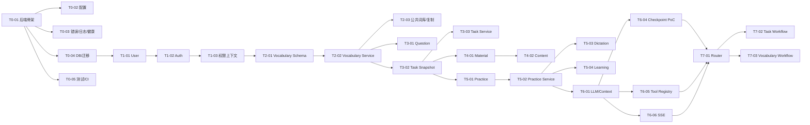

# 家庭学习助手开发任务拆分清单

**版本：** 1.0  
**编制日期：** 2026-11-02  
**用途：** 将正式开发拆分为可独立交给 Codex 执行的小任务  
**依据：** 《正式开发实施计划》《架构审查问题清单》

---

## 1. 使用规则

1. 每个 Task ID 应作为一次独立 Codex 开发任务执行。
2. 开始任务前必须阅读：
   - 系统架构 V1.0。
   - 正式开发实施计划。
   - 架构审查问题清单。
   - 当前任务涉及的模块接口和测试约定。
3. 前置任务未验收，不得跳过依赖直接开发。
4. 每个任务必须控制修改范围，不顺便重构无关模块。
5. 每个任务完成后必须输出：
   - 实现内容。
   - 文件变更。
   - API/数据变更。
   - 测试结果。
   - 未完成项与风险。
6. 关键产品规则未确认时，任务只能实现基础设施或明确标记的临时边界，不得把假设固化为正式数据。
7. 任何阶段不得引入跨模块 Repository 调用。
8. 每个写操作都要在 Service 层完成权限和业务校验。

---

## 2. 依赖关系总览

---

## 3. Phase 0：工程基础

### T0-01：初始化 FastAPI 后端骨架

- **所属阶段：** Phase 0
- **涉及模块：** 基础设施
- **前置任务：** 无
- **输入资料：** 系统架构 V1.0、实施计划 Phase 0
- **预期修改范围：** 新建 `backend/app`、`backend/tests`、`backend/requirements.txt` 或等价依赖文件
- **任务内容：**
  - 创建 FastAPI 应用工厂。
  - 建立 api/core/modules/infrastructure 目录。
  - 提供 `/health/live`。
  - 建立基础启动脚本。
- **交付物：** 可启动的 FastAPI 空骨架。
- **测试要求：** 健康检查测试、启动测试。
- **验收条件：** 本地命令可启动，目录不提前塞入业务实现。

### T0-02：配置管理与密钥边界

- **所属阶段：** Phase 0
- **涉及模块：** 基础设施
- **前置任务：** T0-01
- **输入资料：** 技术架构配置要求
- **预期修改范围：** 配置模块、环境文件示例、README
- **任务内容：**
  - 环境区分：dev/test/prod。
  - 强类型配置。
  - 密钥从环境或安全配置加载。
  - 启动时检查必需配置。
- **交付物：** 配置模块和 `.env.example`。
- **测试要求：** 缺配置失败、敏感配置不写日志。
- **验收条件：** 仓库不包含真实密钥，prod 配置不会静默回退到 dev。

### T0-03：统一异常、日志、请求 ID

- **所属阶段：** Phase 0
- **涉及模块：** 基础设施
- **前置任务：** T0-01
- **输入资料：** 架构错误处理章节
- **预期修改范围：** exceptions、middleware、logging
- **任务内容：**
  - 业务/参数/权限/系统错误分类。
  - 统一 JSON 错误响应。
  - 请求 ID。
  - 禁止返回堆栈。
- **交付物：** 异常与日志基础。
- **测试要求：** 各类异常映射和脱敏。
- **验收条件：** API 错误结构统一，日志能关联 request_id。

### T0-04：数据库连接与 Alembic 迁移基础

- **所属阶段：** Phase 0
- **涉及模块：** 基础设施/Persistence
- **前置任务：** T0-01、T0-02
- **输入资料：** 数据模型章节
- **预期修改范围：** database、migrations、测试数据库配置
- **任务内容：**
  - SQLAlchemy Session。
  - SQLite dev/test。
  - MySQL 连接配置。
  - Alembic 初始迁移。
  - UTC 时间与 JSON 类型约定。
- **交付物：** 可迁移的空数据库。
- **测试要求：** 空库迁移、重复迁移、SQLite/MySQL 配置检查。
- **验收条件：** 不在应用启动时自动造正式表；迁移可追踪。

### T0-05：pytest、CI 与基础质量门禁

- **所属阶段：** Phase 0
- **涉及模块：** 测试基础设施
- **前置任务：** T0-01、T0-04
- **输入资料：** 测试策略
- **预期修改范围：** pytest 配置、测试 fixture、CI 配置
- **任务内容：**
  - 测试数据库隔离。
  - API client fixture。
  - 前端 typecheck/build 纳入 CI。
  - 依赖安全检查。
- **交付物：** 可运行的 CI。
- **测试要求：** CI 在干净环境可执行。
- **验收条件：** PR/提交必须通过测试门禁。

### T0-06：前端 Mock/HTTP API 边界整理

- **所属阶段：** Phase 0
- **涉及模块：** Frontend API
- **前置任务：** T0-01
- **输入资料：** 当前 `frontend/src/api/*`
- **预期修改范围：** 前端 API interface、Mock adapter，不改变页面 UX
- **任务内容：**
  - 定义统一 API contract 或 adapter 接口。
  - 页面依赖 interface，而不是 Mock 实现细节。
  - 为 HTTP 实现预留环境切换。
- **交付物：** 可替换 API 层。
- **测试要求：** 现有 TypeScript 检查和关键页面 smoke。
- **验收条件：** 替换数据源不需要重写页面业务逻辑。

---

## 4. Phase 1：User/Auth/权限

### T1-01：User 模型与 Repository

- **所属阶段：** Phase 1
- **涉及模块：** User
- **前置任务：** T0-04
- **输入资料：** 数据模型 User 章节
- **预期修改范围：** User model/repository/migration/tests
- **任务内容：**
  - users 表。
  - nickname 唯一。
  - password_hash。
  - role/status。
  - user sessions 表，若方案确认。
- **交付物：** User 数据层。
- **测试要求：** 唯一约束、CRUD、密码字段不序列化。
- **验收条件：** Repository 只由 User Service 调用。

### T1-02：Auth Service 与 API

- **所属阶段：** Phase 1
- **涉及模块：** User/Auth
- **前置任务：** T1-01
- **输入资料：** 架构用户登录章节、Auth PoC 结论
- **预期修改范围：** Auth Service、routes、DTO、tests
- **任务内容：**
  - 注册、登录、刷新、退出。
  - 修改密码。
  - 会话撤销。
  - 统一认证 dependency。
- **交付物：** Auth API。
- **测试要求：** 过期、撤销、停用、错误密码、重复昵称。
- **验收条件：** 客户端无法指定可信 user_id/role。

### T1-03：Runtime Context 与权限基础

- **所属阶段：** Phase 1
- **涉及模块：** User/Common
- **前置任务：** T1-02
- **输入资料：** 架构 Runtime Context、权限章节
- **预期修改范围：** security dependencies、permission helpers、test helpers
- **任务内容：**
  - 从认证结果注入 RuntimeContext。
  - 普通用户/管理员依赖。
  - 资源归属校验规范。
- **交付物：** 统一权限上下文。
- **测试要求：** 普通用户、管理员、停用用户、跨用户资源。
- **验收条件：** 所有受保护 API 可复用同一权限机制。

### T1-04：管理员用户管理 API

- **所属阶段：** Phase 1
- **涉及模块：** Admin/User
- **前置任务：** T1-03
- **输入资料：** 架构管理员权限章节
- **预期修改范围：** Admin routes/service
- **任务内容：**
  - 用户列表。
  - 启用/停用。
  - 重置密码。
  - 不返回密码哈希或明文。
- **交付物：** 管理员用户 API。
- **测试要求：** 非管理员 403，管理员不能越权读敏感字段。
- **验收条件：** 管理员不能修改用户学习业务数据。

### T1-05：前端 Auth 接入

- **所属阶段：** Phase 1
- **涉及模块：** Frontend/Auth
- **前置任务：** T1-02、T0-06
- **输入资料：** 登录页原型
- **预期修改范围：** `frontend/src/api`、AppStore、LoginPage
- **任务内容：**
  - 登录/注册/刷新/退出。
  - Token 存储与刷新策略。
  - 401/403 处理。
  - 开发演示数据重置逻辑隔离。
- **交付物：** 真实认证前端。
- **测试要求：** 登录、刷新、登出、会话过期。
- **验收条件：** 页面不再使用 DemoPassword 验证身份。

---

## 5. Phase 2：Vocabulary

### T2-01：Vocabulary、Tag、Entry Schema

- **所属阶段：** Phase 2
- **涉及模块：** Vocabulary
- **前置任务：** T1-03；分类/学科决策
- **输入资料：** 数据模型 Vocabulary、原型词库字段
- **预期修改范围：** models/repositories/migrations/tests
- **任务内容：**
  - vocabularies、vocabulary_tags、word_entries。
  - subject、visibility、published、version。
  - 词形规范化与唯一约束。
  - meanings_json。
- **交付物：** Vocabulary 数据层。
- **测试要求：** 重复词、跨词库同词、标签唯一、JSON 回读。
- **验收条件：** Schema 能支持个人/公共词库且不破坏模块边界。

### T2-02：个人词库与词条 Service

- **所属阶段：** Phase 2
- **涉及模块：** Vocabulary
- **前置任务：** T2-01
- **输入资料：** Vocabulary API 计划
- **预期修改范围：** Vocabulary Service、DTO、tests
- **任务内容：**
  - 个人词库 CRUD。
  - 标签编辑。
  - 词条增删改、批量删除、批量编辑。
  - 用户归属校验。
- **交付物：** Vocabulary Service。
- **测试要求：** 跨用户、重复词、批量事务。
- **验收条件：** 页面与 Agent 可复用该 Service。

### T2-03：公共词库与复制 Service

- **所属阶段：** Phase 2
- **涉及模块：** Vocabulary/Admin
- **前置任务：** T2-02
- **输入资料：** 公共词库规则
- **预期修改范围：** Vocabulary public methods、Admin checks
- **任务内容：**
  - 草稿、发布、撤回、删除。
  - 公共词库复制。
  - 复制版本与独立 ID。
  - 管理员权限。
- **交付物：** 公共词库能力。
- **测试要求：** 复制独立、普通用户禁发布、删除不影响副本。
- **验收条件：** 公共词库可供浏览、复制和创建任务快照。

### T2-04：Vocabulary API

- **所属阶段：** Phase 2
- **涉及模块：** Vocabulary
- **前置任务：** T2-02、T2-03
- **输入资料：** API 计划
- **预期修改范围：** API routes/schemas/tests
- **任务内容：**
  - 列表/详情/创建/更新。
  - 词条 CRUD/批量。
  - 公共复制/发布/撤回。
  - 分页、subject、scope、q。
- **交付物：** Vocabulary HTTP API。
- **测试要求：** DTO、权限、分页、错误码。
- **验收条件：** 前端词库页面可直接替换 Mock。

### T2-05：前端词库真实接入

- **所属阶段：** Phase 2
- **涉及模块：** Frontend/Vocabulary
- **前置任务：** T2-04、T0-06
- **输入资料：** Vocabulary API、原型页面
- **预期修改范围：** Vocabulary 页面与 API adapter
- **任务内容：**
  - 列表/详情/元信息/词条编辑。
  - 公共词库复制。
  - 错误与空状态。
- **交付物：** 真实词库页面。
- **测试要求：** 组件/API integration、权限。
- **验收条件：** 无 LocalStorage 业务数据依赖。

---

## 6. Phase 3：Question 与 Task

### T3-01：Question Schema 与 Service

- **所属阶段：** Phase 3
- **涉及模块：** Question
- **前置任务：** T2-01
- **输入资料：** Question 设计
- **预期修改范围：** question model/repository/service/tests
- **任务内容：**
  - 统一 Question 主表与 JSON 扩展。
  - 结构校验、答案格式规则。
  - 不跨模块访问 Vocabulary。
- **交付物：** Question Service。
- **测试要求：** 结构校验、非法规则、JSON。
- **验收条件：** 领域模块可生成 Question，但规则仍由 Handler 提供。

### T3-02：Task、Snapshot Schema

- **所属阶段：** Phase 3
- **涉及模块：** Task
- **前置任务：** T3-01、T2-01；任务规则确认
- **输入资料：** Task 数据模型
- **预期修改范围：** task models/migrations/repository/tests
- **任务内容：**
  - tasks、task_snapshots、task_snapshot_entries。
  - 状态、进度、config_json。
  - 快照序号与词条字段。
- **交付物：** Task 数据层。
- **测试要求：** 快照独立、序号唯一、级联关系。
- **验收条件：** 原词库变化不影响快照。

### T3-03：Task Service 与 Handler

- **所属阶段：** Phase 3
- **涉及模块：** Task/Vocabulary/Dictation
- **前置任务：** T3-02
- **输入资料：** Task Handler 设计
- **预期修改范围：** Task Service、handler registry
- **任务内容：**
  - 创建、更新任务。
  - 校验 selected_entry_ids。
  - 创建快照事务。
  - 固定/长期规则。
  - 定义 Task 删除公开契约；Practice 数据清理与完整删除事务在 T5-04 完成。
- **交付物：** Task Service 和两个 Handler。
- **测试要求：** 跨用户、非法选词、固定锁定、创建/更新幂等；完整删除级联在 T5-04 验证。
- **验收条件：** 页面/Agent 创建使用同一服务。

### T3-04：Task API

- **所属阶段：** Phase 3
- **涉及模块：** Task
- **前置任务：** T3-03
- **输入资料：** Task API 计划
- **预期修改范围：** routes/schemas/tests
- **任务内容：**
  - 列表、创建、详情、更新、删除。
  - 筛选分页。
  - 权限与错误。
- **交付物：** Task API。
- **测试要求：** 创建/修改/删除、跨用户、管理员边界。
- **验收条件：** 任务页面可替换 Mock。

### T3-05：前端任务真实接入

- **所属阶段：** Phase 3
- **涉及模块：** Frontend/Task
- **前置任务：** T3-04
- **输入资料：** Task API、任务页面原型
- **预期修改范围：** Tasks/TaskCreate/TaskDetail
- **任务内容：**
  - 列表、创建、详情、编辑、删除。
  - 词库/词条选择来自真实 API。
  - 快照和状态展示。
- **交付物：** 真实任务页面。
- **测试要求：** 页面集成、权限、删除二次确认。
- **验收条件：** 无任务 Mock 数据。

---

## 7. Phase 4：Material 与 Content

### T4-01：文件存储抽象与 Material Service

- **所属阶段：** Phase 4
- **涉及模块：** Material
- **前置任务：** T0-04、T1-03
- **输入资料：** 文件存储 PoC
- **预期修改范围：** storage interface、local adapter、material service
- **任务内容：**
  - 元数据表和存储 key。
  - 文件大小/MIME限制。
  - 权限检查。
  - 删除策略。
- **交付物：** Material 上传与访问能力。
- **测试要求：** 越权、大小、MIME、存储失败。
- **验收条件：** 文件正文不写业务表。

### T4-02：Content 解析与预览 Service

- **所属阶段：** Phase 4
- **涉及模块：** Content
- **前置任务：** T4-01
- **输入资料：** Excel 模板、字段映射
- **预期修改范围：** content extraction、parser interface、tests
- **任务内容：**
  - CSV/XLSX 服务端解析。
  - 字段映射、行级错误、重复检测。
  - 预览编辑。
  - 预览过期。
- **交付物：** Content Extraction Service。
- **测试要求：** 正常/异常表格、恶意输入、权限。
- **验收条件：** 未确认不创建正式 Vocabulary。

### T4-03：确认导入 Vocabulary

- **所属阶段：** Phase 4
- **涉及模块：** Content/Vocabulary
- **前置任务：** T4-02、T2-02
- **输入资料：** Content Confirm 规则
- **预期修改范围：** content confirm、idempotency、transaction
- **任务内容：**
  - 用户确认后调用 Vocabulary Service。
  - action/request id 幂等。
  - 预览版本校验。
- **交付物：** 导入闭环。
- **测试要求：** 未确认、重复确认、过期预览、权限。
- **验收条件：** 只创建一次词库，Content 不直接写 Vocabulary 表。

### T4-04：前端真实上传与导入

- **所属阶段：** Phase 4
- **涉及模块：** Frontend/Material/Content/Vocabulary
- **前置任务：** T4-01、T4-02、T4-03
- **输入资料：** 原型上传/预览页面
- **预期修改范围：** VocabularyCreatePage、ChatPage 上传
- **任务内容：**
  - 文件上传。
  - 预览、编辑、确认。
  - 模板下载。
  - 错误展示。
- **交付物：** 真实导入 UI。
- **测试要求：** E2E 导入、失败重试、权限。
- **验收条件：** 页面和 Agent 导入使用同一链路。

---

## 8. Phase 5：Practice、Dictation、Learning

### T5-01：Practice Schema

- **所属阶段：** Phase 5
- **涉及模块：** Practice
- **前置任务：** T3-02
- **输入资料：** Practice 数据模型
- **预期修改范围：** attempts/answers models/migrations
- **任务内容：**
  - Attempt、Answer。
  - evaluation_source。
  - 唯一序号。
  - 用户/任务索引。
- **交付物：** Practice 数据层。
- **测试要求：** 序号唯一、JSON、级联、SQLite/MySQL。
- **验收条件：** 可保存完整答题事实。

### T5-02：Practice Service 与词汇练习 Handler

- **所属阶段：** Phase 5
- **涉及模块：** Practice/Vocabulary/Question
- **前置任务：** T5-01、T3-01
- **输入资料：** Practice 生命周期
- **预期修改范围：** practice service/handler
- **任务内容：**
  - 开始/恢复。
  - 提交答案。
  - 完成 Attempt。
  - 事务保存和状态。
- **交付物：** 词汇练习能力。
- **测试要求：** 中断、重复、跨用户、事务。
- **验收条件：** 刷新后恢复和答题记录一致。

### T5-03：Dictation Handler（线上/线下）

- **所属阶段：** Phase 5
- **涉及模块：** Dictation/Practice
- **前置任务：** T5-02；听写规则确认
- **输入资料：** DictationConfig、原型听写页面
- **预期修改范围：** dictation handler、self-check、validators
- **任务内容：**
  - 听写配置校验。
  - 线上判分。
  - 线下 self-report。
  - 自动播放/朗读次数/提示仅为前端运行配置，后端保存与校验。
- **交付物：** 两种听写模式。
- **测试要求：** 配置校验、自查来源、重复提交。
- **验收条件：** 线上/线下事实可区分、可追溯。

### T5-04：Task 进度重算与删除级联

- **所属阶段：** Phase 5
- **涉及模块：** Task/Practice
- **前置任务：** T5-02、T5-03、T3-03；进度规则确认
- **输入资料：** Task 进度规则
- **预期修改范围：** progress calculator、recalc tests
- **任务内容：**
  - 根据 Practice 事实重算。
  - 重复练习不重复累计。
  - 固定/长期差异。
  - 事务更新。
  - 完成 Task 删除时对 Practice 事实的级联清理。
- **交付物：** 可重算进度服务。
- **测试要求：** 首次/重复/错题/重做/跨组；删除任务与 Practice 记录同一事务。
- **验收条件：** Task.progress 可从事实重建。

### T5-05：Learning 统计与错题

- **所属阶段：** Phase 5
- **涉及模块：** Learning/Practice/Vocabulary
- **前置任务：** T5-02、T5-03
- **输入资料：** Learning 规则
- **预期修改范围：** learning service/API
- **任务内容：**
  - 统计、正确率、最近记录、错题。
  - 掌握状态读取。
  - 复习扩展点。
- **交付物：** Learning 服务。
- **测试要求：** 事实重算、用户隔离、来源区分。
- **验收条件：** 管理员只读可复用。

### T5-06：Practice/Learning API

- **所属阶段：** Phase 5
- **涉及模块：** Practice/Dictation/Learning
- **前置任务：** T5-02、T5-03、T5-05
- **输入资料：** API 计划
- **预期修改范围：** routes/schemas/tests
- **任务内容：**
  - Attempt 开始/恢复/查询。
  - 线上答案和线下自查。
  - Learning 统计/错题。
- **交付物：** 练习与学习 API。
- **测试要求：** 权限、幂等、事务、分页。
- **验收条件：** 前端练习页可替换 Mock。

### T5-07：前端真实练习与学习记录

- **所属阶段：** Phase 5
- **涉及模块：** Frontend/Practice/Learning
- **前置任务：** T5-06
- **输入资料：** 原型练习页面
- **预期修改范围：** VocabularyPractice、DictationPractice、Learning
- **任务内容：**
  - 真实 API、恢复、提交、反馈、结果。
  - 线上/线下/自动/手动配置。
  - 学习统计。
- **交付物：** 真实练习页面。
- **测试要求：** E2E 中断恢复、重复练习、移动端。
- **验收条件：** 无 Mock Attempt/统计。

---

## 9. Phase 6：Agent 基础设施

### T6-01：LLM Adapter

- **所属阶段：** Phase 6
- **涉及模块：** Agent/Infrastructure
- **前置任务：** T0-02、T0-05
- **输入资料：** 架构 LLM Adapter
- **预期修改范围：** llm adapter、config、tests
- **任务内容：**
  - Provider 接口。
  - 超时、重试、错误映射。
  - Token 统计。
  - Mock Adapter。
- **交付物：** 可替换 LLM Adapter。
- **测试要求：** 超时、429、5xx、结构化输出。
- **验收条件：** 业务代码不直接依赖供应商 SDK。

### T6-02：Prompt Registry 与版本记录

- **所属阶段：** Phase 6
- **涉及模块：** Agent/Prompt
- **前置任务：** T6-01
- **输入资料：** Prompt PoC
- **预期修改范围：** prompt registry、templates、tests
- **任务内容：**
  - 文件模板。
  - 变量 Schema。
  - 版本/Git commit。
  - 未来 DB source 扩展点。
- **交付物：** Prompt Registry。
- **测试要求：** 缺变量、版本记录、敏感变量不记录。
- **验收条件：** 每次执行可追踪 Prompt 版本。

### T6-03：Conversation Service/API

- **所属阶段：** Phase 6
- **涉及模块：** Conversation
- **前置任务：** T1-03
- **输入资料：** Conversation 数据模型
- **预期修改范围：** conversation models/service/api
- **任务内容：**
  - 单长期 Conversation。
  - 消息分页、保存、清空。
  - Tool Call/Result 独立消息。
- **交付物：** Conversation API。
- **测试要求：** 用户隔离、消息顺序、Tool 关联。
- **验收条件：** 刷新后历史可恢复；Checkpoint 不参与 Conversation 存储。

### T6-04：LangGraph State 与 Context Builder

- **所属阶段：** Phase 6
- **涉及模块：** Agent
- **前置任务：** T6-01、T6-02、T6-03
- **输入资料：** MainAgentState/Subgraph State
- **预期修改范围：** states/context/graph skeleton
- **任务内容：**
  - RuntimeContext。
  - Main/Subgraph State。
  - Context Builder。
  - Graph 节点边界。
- **交付物：** Graph 骨架。
- **测试要求：** State 序列化、用户身份不可模型覆盖。
- **验收条件：** 业务 ID 与可信身份分离。

### T6-05：Checkpointer PoC 与实现

- **所属阶段：** Phase 6
- **涉及模块：** Agent/Infrastructure
- **前置任务：** T6-04
- **输入资料：** Checkpointer PoC
- **预期修改范围：** checkpoint adapter/PoC docs/tests
- **任务内容：**
  - interrupt/resume。
  - 重启恢复。
  - 并发和清理。
  - MySQL 方案或明确替代。
- **交付物：** 可验证的 Checkpoint 方案。
- **测试要求：** 重复 resume、进程重启、清理。
- **验收条件：** 不使用伪造兼容层。

### T6-06：Tool Registry 与权限

- **所属阶段：** Phase 6
- **涉及模块：** Agent/Tools
- **前置任务：** T1-03、T6-04
- **输入资料：** Tool 设计
- **预期修改范围：** tool registry/schemas/tests
- **任务内容：**
  - Tool Definition、Schema、权限。
  - 统一 ToolResult。
  - Tool 只调用 Service。
- **交付物：** Tool Registry。
- **测试要求：** 权限过滤、参数校验、错误分类。
- **验收条件：** 无权限 Tool 不暴露给 LLM。

### T6-07：SSE 传输与运行状态

- **所属阶段：** Phase 6
- **涉及模块：** Agent/API
- **前置任务：** T6-04、POC-02
- **输入资料：** SSE PoC、事件协议
- **预期修改范围：** SSE endpoint/event serializer/state API
- **任务内容：**
  - envelope。
  - message/progress/tool_status/confirmation/error/done。
  - run 状态查询。
  - 重连游标。
- **交付物：** SSE 能力。
- **测试要求：** 事件顺序、断线、重连、脱敏。
- **验收条件：** 前端可稳定恢复状态。

### T6-08：执行详情与脱敏

- **所属阶段：** Phase 6
- **涉及模块：** Agent/Conversation/Admin
- **前置任务：** T6-06、T6-07
- **输入资料：** 运行详情安全要求
- **预期修改范围：** execution DTO/redaction/tests
- **任务内容：**
  - Graph/Tool/耗时/错误 DTO。
  - 密钥/Token/Cookie/密码脱敏。
  - 权限可见性。
- **交付物：** 执行详情。
- **测试要求：** 敏感字段扫描、角色可见性。
- **验收条件：** 详情完整但无敏感信息。

---

## 10. Phase 7：Agent Workflows

### T7-01：Intent Router 与程序校验

- **所属阶段：** Phase 7
- **涉及模块：** Agent
- **前置任务：** T6-04、T6-06
- **输入资料：** Main Router 设计
- **预期修改范围：** router nodes/schemas/tests
- **任务内容：**
  - 结构化 Intent。
  - 程序验证 Route/参数/权限。
  - 不明确时澄清。
- **交付物：** Main Router。
- **测试要求：** Mock LLM 固定意图、无权限、缺参。
- **验收条件：** 不能只依赖模型置信度执行写操作。

### T7-02：Action Model、Draft 编辑与 Hash

- **所属阶段：** Phase 7
- **涉及模块：** Agent
- **前置任务：** T7-01
- **输入资料：** AUD-P0-03 解决方案
- **预期修改范围：** PendingAction schema/draft patch/confirm
- **任务内容：**
  - action_id。
  - config_hash。
  - draft patch 生成新 action。
  - 旧 action 失效。
  - 幂等。
- **交付物：** 可编辑确认协议。
- **测试要求：** 编辑、旧 ID、重复确认、并发。
- **验收条件：** 用户确认内容与执行配置严格一致。

### T7-03：Task Workflow

- **所属阶段：** Phase 7
- **涉及模块：** Agent/Task
- **前置任务：** T3-03、T7-02
- **输入资料：** Task Workflow
- **预期修改范围：** graph nodes/tools/prompts/tests
- **任务内容：**
  - 创建、修改、删除。
  - 信息补充。
  - 结构化预览。
  - 两阶段删除。
  - 取消和恢复。
- **交付物：** Task Workflow。
- **测试要求：** 未确认不写、编辑后新 action、重复确认、删除确认。
- **验收条件：** 与页面 Task Service 共用业务能力。

### T7-04：Vocabulary/Import Workflow

- **所属阶段：** Phase 7
- **涉及模块：** Agent/Material/Content/Vocabulary
- **前置任务：** T2-03、T4-03、T7-02
- **输入资料：** Content/Vocabulary Workflow
- **预期修改范围：** graph/tool/prompt/tests
- **任务内容：**
  - 创建词库。
  - 文件解析预览。
  - 全部字段编辑。
  - 确认保存。
- **交付物：** 词库 Workflow。
- **测试要求：** 编辑、取消、重复确认、解析失败。
- **验收条件：** 与页面创建使用同一 Service。

### T7-05：Learning Workflow

- **所属阶段：** Phase 7
- **涉及模块：** Agent/Learning
- **前置任务：** T5-05、T7-01
- **输入资料：** Learning Workflow
- **预期修改范围：** graph/tool/tests
- **任务内容：**
  - 统计摘要。
  - 错题/最近练习。
  - 只读权限。
- **交付物：** Learning Workflow。
- **测试要求：** 用户隔离、空数据、管理员只读。
- **验收条件：** 不修改学习事实。

### T7-06：Workflow 取消、挂起与异常

- **所属阶段：** Phase 7
- **涉及模块：** Agent
- **前置任务：** T7-02、T7-03、T7-04
- **输入资料：** Workflow 管理规则
- **预期修改范围：** graph transitions/tests
- **任务内容：**
  - 单活动 Workflow。
  - 无关问题挂起。
  - 用户取消。
  - 错误/重试边界。
- **交付物：** 稳定 Workflow 生命周期。
- **测试要求：** 挂起、恢复、取消、并发、异常。
- **验收条件：** Pending Action 不丢失且不能重复执行。

---

## 11. Phase 8：前后端联调

### T8-01：HTTP Client、Token 与错误处理

- **所属阶段：** Phase 8
- **涉及模块：** Frontend/API
- **前置任务：** T1-05、T0-06
- **输入资料：** 正式 API 错误规范
- **预期修改范围：** api client、auth interceptor
- **任务内容：**
  - base URL。
  - token 注入。
  - refresh。
  - 统一错误。
- **交付物：** 前端 HTTP Client。
- **测试要求：** 401/403/网络错误、刷新。
- **验收条件：** 页面不直接 fetch 业务 API。

### T8-02：Chat SSE 与执行详情

- **所属阶段：** Phase 8
- **涉及模块：** Frontend/Agent
- **前置任务：** T6-07、T7-03、T7-04
- **输入资料：** SSE 协议、确认卡原型
- **预期修改范围：** ChatPage、MessageComponents、ActionEditor
- **任务内容：**
  - 流式事件。
  - 断线重连。
  - 可编辑草稿同步。
  - 执行详情。
- **交付物：** 真实 Agent 对话。
- **测试要求：** 流式、断线、重连、确认、取消。
- **验收条件：** 前端不自行推断后端运行状态。

### T8-03：任务与词库页面真实接入

- **所属阶段：** Phase 8
- **涉及模块：** Frontend/Task/Vocabulary
- **前置任务：** T3-05、T2-05、T8-01
- **输入资料：** 后端 API
- **预期修改范围：** Task/Vocabulary pages
- **任务内容：**
  - 真实列表、详情、创建、编辑、删除。
  - 分页与错误。
- **交付物：** 真实任务/词库页面。
- **测试要求：** 页面 E2E、权限、删除确认。
- **验收条件：** 无业务 Mock 数据。

### T8-04：练习与 Learning 真实接入

- **所属阶段：** Phase 8
- **涉及模块：** Frontend/Practice/Learning
- **前置任务：** T5-07、T8-01
- **输入资料：** Practice/Learning API
- **预期修改范围：** Practice/Learning pages
- **任务内容：**
  - Attempt 恢复、答案、离线自查。
  - 统计/错题。
- **交付物：** 真实练习与统计。
- **测试要求：** E2E 中断恢复、重复练习、来源区分。
- **验收条件：** 无 Mock Attempt。

### T8-05：Admin 真实接入

- **所属阶段：** Phase 8
- **涉及模块：** Frontend/Admin
- **前置任务：** T1-04、T2-03、T5-05、T8-01
- **输入资料：** Admin API
- **预期修改范围：** AdminPage
- **任务内容：**
  - 用户、公共词库、日志、只读学习。
- **交付物：** 真实管理后台。
- **测试要求：** 普通用户 403、管理员只读边界。
- **验收条件：** 无明文密码泄漏。

### T8-06：移除 Mock 业务依赖与前端回归

- **所属阶段：** Phase 8
- **涉及模块：** Frontend 全部
- **前置任务：** T8-01–T8-05
- **输入资料：** 前端实施记录
- **预期修改范围：** Mock adapter、开发开关
- **任务内容：**
  - Mock 仅保留隔离的开发/测试能力。
  - 清理 LocalStorage 业务数据依赖。
  - 首页/断网/空数据。
- **交付物：** 正式前端数据链路。
- **测试要求：** 无 Mock 运行、页面 smoke、敏感数据扫描。
- **验收条件：** 默认构建连接真实 API。

---

## 12. Phase 9：验证与部署

### T9-01：MySQL 专项与迁移验证

- **所属阶段：** Phase 9
- **涉及模块：** 基础设施/全部持久化
- **前置任务：** T0-04、各模块迁移完成
- **输入资料：** 数据模型
- **预期修改范围：** MySQL CI、迁移测试、兼容性文档
- **任务内容：**
  - 空库迁移。
  - JSON、索引、唯一约束、时间时区。
  - SQLite/MySQL 行为对照。
- **交付物：** MySQL 验证报告。
- **测试要求：** 关键 Repository/Service 在 MySQL 重跑。
- **验收条件：** 不以 SQLite 通过代替 MySQL 验证。

### T9-02：E2E 全链路

- **所属阶段：** Phase 9
- **涉及模块：** 全部
- **前置任务：** Phase 8
- **输入资料：** 核心验收流程
- **预期修改范围：** Playwright/E2E 测试
- **任务内容：**
  - 登录、任务、词库、练习、学习、管理、Agent。
- **交付物：** E2E 套件。
- **测试要求：** 桌面和移动视口、失败重试。
- **验收条件：** 关键写操作全部有硬断言。

### T9-03：安全检查与性能验证

- **所属阶段：** Phase 9
- **涉及模块：** 全部
- **前置任务：** T9-02
- **输入资料：** 权限与安全章节
- **预期修改范围：** security tests、load scripts、报告
- **任务内容：**
  - 跨用户、管理员越权、文件、SSE、Token、日志脱敏。
  - LLM 超时/限流。
  - 大表格和并发练习。
- **交付物：** 安全/性能报告。
- **测试要求：** 无高危依赖漏洞、无敏感信息泄露。
- **验收条件：** 生产风险可接受并有缓解措施。

### T9-04：部署、监控与回滚

- **所属阶段：** Phase 9
- **涉及模块：** 基础设施
- **前置任务：** T9-01–T9-03
- **输入资料：** 部署环境
- **预期修改范围：** Docker/部署脚本/配置文档/监控
- **任务内容：**
  - 环境部署。
  - 健康检查。
  - 日志、指标、告警。
  - 备份恢复。
  - 发布回滚。
- **交付物：** 可部署版本。
- **测试要求：** 故障演练、恢复演练。
- **验收条件：** 具备生产运行和恢复能力。

---

## 13. 建议的首批执行任务

正式开发获批后，首批只执行：

1. **T0-01** 后端骨架。
2. **T0-02** 配置。
3. **T0-03** 异常/日志/请求 ID。
4. **T0-04** 数据库与迁移。
5. **T0-05** 测试/CI。
6. **T0-06** 前端 API 边界整理。

在 Phase 0 验收前，不启动 User、Vocabulary、Task 或 Agent 业务实现。
