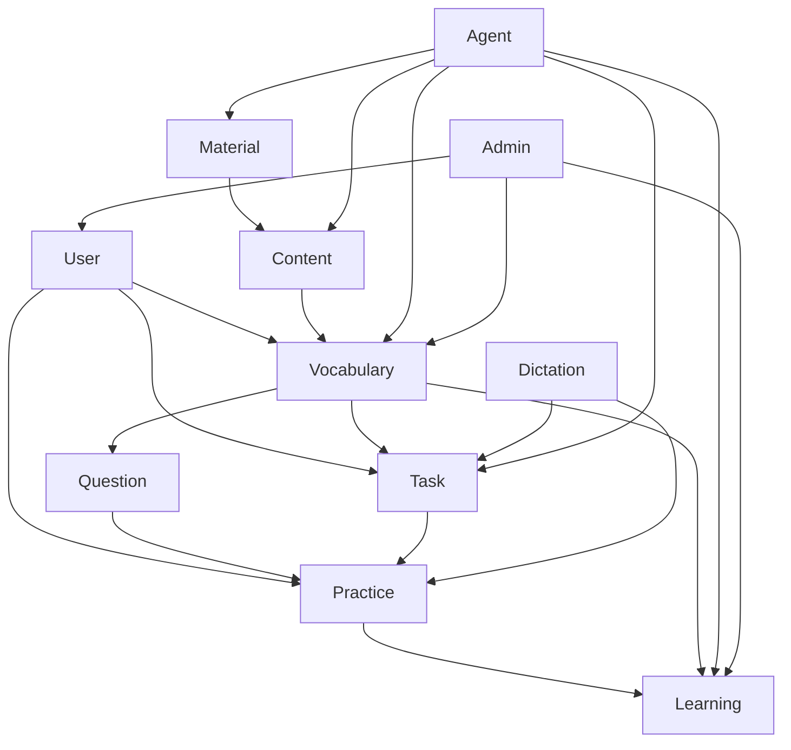

# 家庭学习助手正式开发实施计划

**版本：** 1.0  
**编制日期：** 2026-11-02  
**阶段：** 正式开发前准备  
**状态：** 待产品与技术审核  
**决策基线：** `docs/正式开发决策记录.md` 中的已批准选择优先于本计划中的待确认默认值。

**依据：** 《家庭学习助手系统架构与开发设计文档 V1.0》、已通过的前端原型及实际代码审查

---

## 1. 文档目的

本计划用于指导家庭学习助手从 Phase 0 前端原型进入正式开发。

本计划解决的问题：

- 将现有前端原型能力映射到后端模块和 API。
- 明确正式数据库的逻辑模型及模块数据归属。
- 明确 Agent、Conversation、Checkpoint、业务 Service 的实现边界。
- 给出按依赖关系和风险排序的开发阶段。
- 给出每个阶段的交付物、测试要求和验收标准。
- 将后续开发拆成可独立执行的 Codex 任务。

本计划不包含：

- 实际业务代码。
- SQL/ORM 实现。
- 数据库迁移执行。
- 完整 OpenAPI Schema。
- 对现有前端原型的修改。

---

## 2. 项目现状

### 2.1 已有交付

| 类别 | 现状 |
| --- | --- |
| 系统架构 | 已完成 V1.0，明确技术栈、模块边界、Agent、任务、练习和权限方向 |
| 前端设计 | 已完成原型设计方案，核心视觉与交互已验收 |
| 前端实现 | React + TypeScript + Vite 可运行原型，路由、页面、Mock API、Mock Agent 已实现 |
| 数据 | 浏览器 LocalStorage |
| Agent | Mock Agent，事件格式与目标 SSE 类似，但没有真实网络、LLM、LangGraph |
| 文件解析 | 页面创建词库使用浏览器端真实 `.xlsx/.csv` 解析；Agent 上传仍为固定模拟 |
| 管理员 | 原型内有 Admin、Manager 两个演示管理员 |
| 后端 | 尚未创建 |
| 数据库 | 尚未创建 |
| 自动化测试 | 前端只有 `typecheck` 和 `build`，尚无测试框架 |

### 2.2 前端实际路由

| 路由 | 页面 | 权限 |
| --- | --- | --- |
| `/login` | 登录/注册 | 匿名 |
| `/` | Agent 对话 | 登录用户 |
| `/tasks` | 任务列表 | 登录用户 |
| `/tasks/new` | 页面创建任务 | 登录用户 |
| `/tasks/:taskId` | 任务详情 | 任务所有者；管理员不能代替操作 |
| `/vocabulary` | 个人/公共词库列表 | 登录用户 |
| `/vocabulary/new` | 页面创建词库、Excel/CSV 导入 | 登录用户；管理员可创建公共词库 |
| `/vocabulary/:libraryId` | 词库详情 | 所有者、已发布公共词库、或管理员 |
| `/practice/vocabulary/:taskId` | 词汇练习 | 任务所有者 |
| `/practice/dictation/:taskId` | 线上/线下听写练习 | 任务所有者 |
| `/learning` | 学习记录 | 登录用户 |
| `/admin` | 管理后台 | 管理员 |

### 2.3 前端核心能力

- ChatGPT 式 Agent 对话与固定快捷入口。
- 结构化消息、Tool 状态、操作预览、确认/取消、执行详情。
- Agent 创建/修改/删除任务，删除采用两阶段确认。
- Agent 导入词库，支持在确认卡片中编辑学科、名称、描述、标签及全部词条字段。
- 页面创建任务，支持学科筛选、个人/公共词库、词条勾选、序号表达式、长期分组与听写参数。
- 页面创建词库，支持学科、标签、Excel/CSV 导入、模板下载与词条编辑。
- 公共词库浏览、复制、管理员发布/撤回/编辑。
- 独立词汇练习、线上听写、线下自查听写。
- 学习统计、错题、掌握数量、最近记录。
- 管理员用户列表、学习概况、密码重置、公共词库和操作日志。

### 2.4 前端代码审查结论

**符合架构方向：**

- React + TypeScript + Vite。
- 页面、公共组件、领域类型、Mock API、Mock Agent 已分层。
- Agent 与页面业务操作共用 Mock API 入口。
- Agent 对话和独立练习页面分离。
- 设计 Token 与公共组件统一。
- 用户数据隔离、管理员只读边界已在 Mock Service 中部分体现。
- Agent 写操作有确认卡片和两阶段删除交互。

**正式开发必须替换或重构：**

- LocalStorage 数据源。
- LocalStorage 认证和演示密码。
- 浏览器端业务“Service”合并实现。
- Mock Agent 的关键词路由和固定延时。
- 不完整的事件 envelope 与无重连的伪 SSE。
- 浏览器端 Excel 解析作为正式导入方案。
- 内存/单页 Store 直接驱动全部业务数据的模式。
- 原型简化版任务进度和掌握算法。

---

## 3. 架构审查结论

### 3.1 保持不变的核心决策

1. React + TypeScript 前端。
2. Python + FastAPI 后端。
3. LangGraph 负责 Agent 工作流，不承载业务数据。
4. MySQL 为生产数据库，SQLite 只用于本地开发。
5. 统一 LLM Adapter。
6. Single Agent + Internal Subgraphs。
7. Agent 不直接访问数据库或 Repository。
8. 业务写操作必须经过 Service。
9. 模块拥有自己的数据和规则。
10. Conversation、Checkpoint 和业务数据分离。
11. Tool Registry 权限过滤 + Service 二次校验。
12. 重要写操作预览、确认、幂等。
13. 删除任务两阶段确认。
14. 管理员不能代替用户修改任务、答案或掌握状态。
15. Prompt 文件化、版本化，MVP 不提供 Prompt 管理后台。
16. 所有正式 API 必须认证、授权和审计关键写操作。

### 3.2 原型确定的正式产品基线

| 决策 | 原型现状 | 正式影响 |
| --- | --- | --- |
| 学科 | 英语/语文 | Vocabulary、Task、Question、Listening/Dictation |
| 分类 | UI 已移除，类型仍保留 | Vocabulary 数据表和迁移 |
| 任务数量 | 由勾选词条数量决定 | Task/Practice 规则 |
| 固定任务 | 无需数量/分组 | Task Handler 和进度 |
| 长期任务 | 无需学习数量，可配置每组数量 | Task Handler、分组规则 |
| 公共词库任务 | 可直接使用已发布公共词库 | Task 权限与快照 |
| 听写配置 | 线上/线下、自动/手动、间隔、朗读次数、提示内容 | Dictation/Practice API |
| 确认卡内编辑 | 任务、词库均可编辑 | action_id、config_hash、PATCH action draft |
| 页面创建 | 任务和词库均可直接创建 | 正式 HTTP API |
| 管理员账号 | 两个演示管理员 | 仅原型，不作为正式 seed 规则 |

以上内容已经由 `docs/正式开发决策记录.md` 批准，不再作为待确认事项；实现时以决策记录为最终口径。

### 3.3 模块依赖方向



约束：

- 箭头表示调用公开 Service，不代表允许跨模块数据库访问。
- Task/Practice 只通过 Handler 使用 Vocabulary/Dictation 领域能力。
- Learning 读取 Practice/Vocabulary 的公开查询能力，不直接修改其数据。
- Admin 复用对应业务模块的公开管理接口。

---

## 4. 前后端映射

| 前端页面/功能 | 后端模块 | 主要 API | Agent 发起 | SSE | 用户确认 | 正式替换项 |
| --- | --- | --- | --- | --- | --- | --- |
| 登录/注册 | User/Auth | 注册、登录、刷新、退出、当前用户 | 否 | 否 | 否 | 替换 LocalStorage 演示认证 |
| 应用壳/账户 | User | 当前用户、改昵称/密码、退出 | 否 | 否 | 修改密码建议确认 | 真实 token 和账户状态 |
| Agent 对话与历史 | Conversation/Agent | 当前会话、消息、运行、SSE | 是 | 是 | 视操作类型 | 替换 Mock Agent 和 LocalStorage 消息 |
| Agent 普通问答 | Agent | Agent 运行 SSE | 是 | 是 | 否 | 真实 LLM Adapter |
| Agent 创建/修改任务 | Agent→Task | Action Draft、Confirm、Task Preview/Create/Update | 是 | 是 | 是 | draft_version、config_hash、Workflow、Tool |
| Agent 删除任务 | Agent→Task | Action Draft、Confirm×2、Delete | 是 | 是 | 两次 | checkpointer + 幂等删除 |
| Agent 导入词库 | Agent→Material/Content→Vocabulary | 上传、解析预览、编辑预览、确认导入 | 是 | 是 | 是 | 统一 Content 流程 |
| 对话内导入词库编辑 | Content/Vocabulary | 编辑 extraction、confirm | 是 | 是 | 是 | 服务端可编辑 preview schema |
| 任务列表 | Task | 查询任务、统计摘要 | 否 | 否 | 否 | 真实分页与权限 |
| 页面创建任务 | Task | 词库可用列表、Task Create | 否 | 否 | 页面提交即确认 | 快照和配置校验 |
| 任务详情/编辑/删除 | Task | 详情、更新、两阶段删除 | 可选 | 否 | 页面删除二次确认 | 正式权限和事务 |
| 词库列表 | Vocabulary | 我的/公共/可用词库 | 选择性 | 否 | 否 | 真实筛选、分页 |
| 页面创建词库 | Material/Content/Vocabulary | 上传、解析、预览、确认、创建 | 否 | 否 | 导入需确认 | 服务端解析 |
| 词库详情/词条编辑 | Vocabulary | 词库更新、词条 CRUD/批量 | 选择性 | 否 | 批量删除建议确认 | 真实归属校验 |
| 公共词库复制 | Vocabulary | Copy | 否 | 否 | 否 | 事务复制，复制后独立 |
| 词汇练习（原型保留，不进入 V1 正式入口） | Practice/Question/Vocabulary | 原型可保留，正式 API 暂不开放 | 否 | 否 | 否 | 后续版本再评估 |
| 线上听写 | Practice/Dictation | 开始、提交、恢复 | 否 | 否 | 否 | 服务端判分和事实记录 |
| 线下听写 | Practice/Dictation | 开始、自查提交 | 否 | 否 | 提交自查 | 自查事实字段 |
| 学习记录 | Learning | 统计、Attempt、错题、复习 | 可查询 | 是（Agent 查询） | 否 | 从事实重算 |
| 管理后台用户 | Admin/User/Learning | 用户列表、状态、重置密码、只读学习 | 否 | 否 | 重置密码确认 | 正式只读边界和审计 |
| 管理后台公共词库 | Admin/Vocabulary | 草稿、词条、发布/撤回、删除 | 否 | 否 | 发布/删除确认 | 管理权限 |
| 操作日志 | Admin | 日志查询 | 否 | 否 | 否 | 审计表与查询 |
| 执行详情 | Agent/Conversation | 运行详情、Tool 调用、脱敏数据 | 是 | 是/查询 | 否 | LangSmith + 产品展示 DTO |

### 4.1 Agent 与页面共用 Service

| 能力 | Agent 调用路径 | 页面调用路径 | 共同 Service |
| --- | --- | --- | --- |
| 创建任务 | Tool/Workflow → Task Service | POST Task API → Task Service | TaskService |
| 修改任务 | Workflow → Task Service | PATCH Task API → Task Service | TaskService |
| 删除任务 | Workflow → Task Service | DELETE Task API → Task Service | TaskService |
| 创建词库 | Workflow → Vocabulary Service | POST Vocabulary API | VocabularyService |
| 导入词库 | Material/Content Workflow → Vocabulary Service | Material/Content API → Vocabulary Service | MaterialService/ContentService/VocabularyService |
| 开始练习 | Agent 不执行练习 | Practice API | PracticeService |
| 查询学习记录 | Learning Tool | Learning API | LearningService |

---

## 5. 逻辑数据模型

### 5.1 通用约定

- 主键：统一使用 `CHAR(36)` UUID 字符串，便于 SQLite/MySQL 兼容。
- 时间：统一 UTC `DATETIME(6)`；API 输出 ISO 8601 带时区。
- 枚举：使用 VARCHAR + Service 校验，避免 SQLite/MySQL ENUM 差异。
- JSON：使用 SQLAlchemy JSON 抽象，Pydantic 做结构验证。
- 同模块内部可使用外键；跨模块只保存公开 ID，不建立 ORM 关系或跨模块 Repository 访问。
- 所有业务表包含 `created_at`、`updated_at`。
- 密码、Token、Cookie 等敏感字段不返回 DTO，不进入执行详情。
- Checkpoint 表由 LangGraph Saver 管理，不纳入业务迁移和 ORM 模型。

### 5.2 User 模块

#### `users`

| 字段 | 说明 |
| --- | --- |
| id | PK |
| nickname | 全局唯一 |
| password_hash | 强哈希，绝不下发给前端 |
| role | `user/admin` |
| status | `active/disabled` |
| last_active_at | 最近活跃 |
| created_at / updated_at | 时间 |

唯一约束：`nickname`。  
禁止：Demo 密码、明文密码、客户端指定角色。

#### `user_sessions`

| 字段 | 说明 |
| --- | --- |
| id | PK |
| user_id | 用户 |
| refresh_token_hash | 刷新令牌摘要 |
| expires_at | 过期时间 |
| revoked_at | 撤销时间 |
| created_at | 创建时间 |

登录方案需确认 JWT Access Token + 可撤销 Refresh Session，或等价的短期会话方案。

### 5.3 Vocabulary 模块

#### `subjects`

| 字段 | 说明 |
| --- | --- |
| code | `english/chinese`，主键 |
| display_name | 英语/语文 |
| enabled | 是否开放 |
| sort_order | 展示顺序 |

V1 只初始化英语、语文。

#### `vocabularies`

| 字段 | 说明 |
| --- | --- |
| id | PK |
| owner_user_id | 个人词库所有者；公共词库为空 |
| subject | `english/chinese`，仅允许配置值 |
| name | 词库名称 |
| description | 描述 |
| visibility | `personal/public` |
| published | 公共词库是否发布 |
| source_vocabulary_id | 复制来源公共词库；公共词库不存在历史版本 |
| created_at / updated_at | 时间 |

索引：`(owner_user_id, subject)`、`(visibility, published, subject)`。

#### `vocabulary_tags`

| 字段 | 说明 |
| --- | --- |
| id | PK |
| vocabulary_id | 所属词库 |
| name | 自定义标签 |
| created_at | 时间 |

唯一约束：`(vocabulary_id, normalized_name)`。

#### `word_entries`

| 字段 | 说明 |
| --- | --- |
| id | PK |
| vocabulary_id | 所属词库 |
| word | 展示词形 |
| normalized_word | NFKC + trim + casefold 后的唯一键 |
| phonetic | 英语音标或语文拼音 |
| part_of_speech | 词性/词语类型 |
| meanings_json | 多词义数组 |
| example | 例句/语境 |
| example_translation | 例句翻译/说明 |
| position | 词条序号 |
| created_at / updated_at | 时间 |

唯一约束：`(vocabulary_id, normalized_word)`。  
JSON：`meanings_json`。

#### `vocabulary_entry_learning_states`（Vocabulary 拥有）

| 字段 | 说明 |
| --- | --- |
| id | PK |
| user_id | 用户 |
| vocabulary_entry_id | 词条 |
| status | `learning/mastered` 等配置化状态 |
| correct_streak | 连续正确次数 |
| last_answer_id | 最近答题事实引用 |
| next_review_at | 下次复习时间，若算法确定后启用 |
| updated_at | 时间 |

唯一约束：`(user_id, vocabulary_entry_id)`。  
注意：跨词库重复词是否共享掌握状态尚未确认，不能默认为全局共享。

### 5.4 Material 模块

#### `materials`

| 字段 | 说明 |
| --- | --- |
| id | PK |
| user_id | 上传者 |
| original_filename | 原文件名 |
| mime_type | MIME |
| size_bytes | 大小 |
| storage_key | 文件存储抽象中的 key |
| checksum | 文件摘要，建议保留 |
| status | `uploaded/parsed/failed/deleted` |
| created_at / updated_at | 时间 |

不将文件正文存入业务数据库。

### 5.5 Content 模块

#### `content_extractions`

| 字段 | 说明 |
| --- | --- |
| id | PK |
| user_id | 用户 |
| material_id | 来源文件 |
| stage | 解析阶段 |
| parser_type | csv/xlsx/ocr/text |
| status | `processing/previewed/confirmed/failed` |
| extracted_json | 预览结果、字段映射和原始行 |
| errors_json | 行级错误 |
| confirmed_at | 确认时间 |
| expires_at | 草稿可清理时间 |
| created_at / updated_at | 时间 |

JSON：`extracted_json`、`errors_json`。  
Content 只保存加工预览，不是正式 Vocabulary 数据。确认后通过 Vocabulary Service 落正式表。

### 5.6 Question 模块

#### `questions`

| 字段 | 说明 |
| --- | --- |
| id | PK |
| subject | 学科 |
| question_type | 题型 |
| prompt_json | 展示内容、选项、提示 |
| answer_json | 标准答案和判分参数 |
| rule_json | 通用规则配置 |
| source_module | `vocabulary/dictation/...` |
| source_ref_id | 领域对象 ID |
| created_at / updated_at | 时间 |

JSON：`prompt_json`、`answer_json`、`rule_json`。  
Question 不直接 JOIN 或读取 Vocabulary/Dictation 表；领域规则仍由对应模块 Service 提供。

### 5.7 Task 模块

#### `tasks`

| 字段 | 说明 |
| --- | --- |
| id | PK |
| user_id | 任务所有者 |
| name | 名称 |
| subject | 学科快照 |
| task_type | V1 正式仅接受 `dictation`；`vocabulary` 值保留为未来兼容，不开放 API 创建 |
| task_mode | `fixed/long_term` |
| status | `in_progress/completed` |
| progress | 0-100 派生缓存 |
| target_count | 已选词条数量 |
| library_source_id | 来源词库 ID |
| config_json | 分组、强制重做、听写配置等 |
| created_at / updated_at | 时间 |

JSON：`config_json`。听写配置 JSON 由 Dictation Handler/Service 校验。

#### `task_snapshots`

| 字段 | 说明 |
| --- | --- |
| id | PK |
| task_id | 所属任务 |
| source_library_id | 来源词库 |
| created_at | 创建时间 |

唯一：`task_id`。

#### `task_snapshot_entries`

| 字段 | 说明 |
| --- | --- |
| id | PK |
| snapshot_id | 快照 |
| source_entry_id | 来源词条，可空 |
| sequence_no | 1-based 序号 |
| word / normalized_word | 词形 |
| phonetic / part_of_speech | 音标/拼音、词性 |
| meanings_json | 词义数组 |
| example / example_translation | 例句 |
| created_at | 时间 |

唯一：`(snapshot_id, sequence_no)`。

任务创建时：
1. Task Service 通过 Vocabulary 公开接口取得用户可访问词条。
2. 校验 `selected_entry_ids` 属于该词库、未重复、非空。
3. 在事务中创建 Task + Snapshot + Entries。
4. 后续词库修改不会影响任务快照。

### 5.8 Practice 模块

#### `practice_attempts`

| 字段 | 说明 |
| --- | --- |
| id | PK |
| task_id | 任务 |
| user_id | 用户 |
| task_type | 类型快照 |
| status | `in_progress/completed` |
| current_index | 当前进度 |
| total | 本次题目数 |
| started_at / completed_at | 时间 |
| updated_at | 最近保存 |

索引：`(user_id, task_id, status)`。

#### `practice_answers`

| 字段 | 说明 |
| --- | --- |
| id | PK |
| attempt_id | Attempt |
| question_id | Question，可空 |
| snapshot_entry_id | 快照词条引用 |
| sequence_no | 答题顺序 |
| prompt_json | 题目快照 |
| expected_json | 标准答案快照 |
| answer_json | 用户答案 |
| is_correct | 是否判对 |
| evaluation_source | `auto/self_report` |
| answered_at / duration_ms | 事实数据 |

唯一约束：`(attempt_id, sequence_no)`；同一题目是否允许重答由 Handler 规则决定。  
线下听写会把未勾选的词记录为 self_report 正确，勾选词记录为 self_report 错误；按已批准决策，该事实完整计入正确率、掌握状态和复习计划，同时保留 `evaluation_source`。

### 5.9 Dictation 模块

MVP 不单独建立 Task/Dictation 混合数据表。Dictation 提供：

- 听写配置 Schema 和校验。
- 线上/线下 Practice Handler。
- 发音/提示/重复播放配置语义。
- 听写领域答案验证规则。

如果未来需要独立 Dictation 配置版本或音频资产，再增加对应表，不提前抽象。

### 5.10 Learning 模块

MVP 的统计和错题优先通过 Practice + Vocabulary 公开查询实时计算：

- 练习次数。
- 平均正确率。
- 词汇/听写分项正确率。
- 最近练习。
- 错题。

以下数据需要规则确认后决定是否落表：

- 连续正确阈值。
- 已掌握状态。
- 自动复习计划。
- 下次复习时间。

可选逻辑表：`learning_review_items`，保存用户、来源答题事实、词条引用、状态、下次复习时间。该表只有在复习算法确认后才创建。

### 5.11 Conversation 模块

#### `conversations`

| 字段 | 说明 |
| --- | --- |
| id | PK |
| user_id | 所有者 |
| title | 标题 |
| status | 状态 |
| created_at / updated_at | 时间 |

MVP 每用户一个长期 Conversation，但 Schema 不限制未来多会话。

#### `conversation_messages`

| 字段 | 说明 |
| --- | --- |
| id | PK |
| conversation_id | 会话 |
| sequence_no | 会话内严格递增序号 |
| message_type | user/assistant/tool_call/tool_result/system |
| content_json | 结构化内容 |
| tool_call_id | Tool 关联 |
| run_id | Agent 执行引用，可空 |
| created_at | 时间 |

唯一：`(conversation_id, sequence_no)`。


### 5.12.1 Agent 运行事件

#### `agent_run_events`

| 字段 | 说明 |
| --- | --- |
| event_id | PK |
| run_id | Agent 执行 ID |
| conversation_id | 会话 ID |
| sequence | 运行内递增序号 |
| event_type | message/progress/tool_status/confirmation_required/error/done |
| payload_json | 脱敏事件数据 |
| created_at | 时间 |

唯一：`(run_id, sequence)`。

该表用于 SSE 断线重连和事件补发，不替代 Conversation 或 Checkpoint。

### 5.12 Admin / Audit

#### `operation_logs`

| 字段 | 说明 |
| --- | --- |
| id | PK |
| actor_user_id | 操作人 |
| action | 操作类型 |
| target_type | 目标类型 |
| target_id | 目标 ID |
| target_name | 目标名称快照 |
| result | success/error |
| error_code | 可空 |
| metadata_json | 脱敏附加信息 |
| request_id | 请求关联 |
| created_at | 时间 |

不得把密码、Token、完整文件内容、敏感 Prompt 配置写入审计日志。

### 5.13 Checkpoint

LangGraph Checkpoint 使用独立存储和独立迁移机制，不纳入业务模块 Repository。  
若使用 MySQL，必须通过 PoC 确认具体 Saver、表结构、序列化和恢复行为。

---

## 6. API 设计

### 6.1 通用约定

- 前缀：`/api/v1`
- 认证：Bearer Access Token（具体会话方案待确认）。
- 普通业务页面：标准 JSON HTTP API。
- Agent：HTTP + SSE 流。
- 所有错误返回结构化错误码，不返回堆栈。
- 所有写 API 要求授权；关键写 API 建议 `Idempotency-Key`。
- 列表 API 默认分页，MVP 也必须有 `limit` 上限。
- 管理员 API 在 Service 层二次验证角色。

### 6.2 SSE 事件

```json
{
  "event_id": "evt-...",
  "conversation_id": "conv-...",
  "run_id": "run-...",
  "sequence": 12,
  "type": "progress",
  "timestamp": "2026-11-02T10:00:00+08:00",
  "data": {}
}
```

类型：

- `message`
- `progress`
- `tool_status`
- `confirmation_required`
- `error`
- `done`

### 6.3 Auth / User API

| Method | URL | 模块 | 功能 | 请求概要 | 返回概要 | 权限 | 事务 | 幂等 |
| --- | --- | --- | --- | --- | --- | --- | --- | --- |
| POST | `/auth/register` | User | 注册 | nickname/password | user + tokens | 匿名 | 是 | 昵称唯一 |
| POST | `/auth/login` | User | 登录 | nickname/password | user + tokens | 匿名 | 是 | 否 |
| POST | `/auth/refresh` | User | 刷新会话 | refresh token | access token | 有效 Refresh | 是 | 是 |
| POST | `/auth/logout` | User | 退出 | session token | 204 | 登录 | 是 | 是 |
| GET | `/users/me` | User | 当前用户 | 无 | User DTO | 登录 | 否 | 是 |
| PATCH | `/users/me` | User | 修改昵称/资料 | patch fields | User DTO | 登录 | 是 | 建议 |
| POST | `/users/me/password` | User | 修改密码 | old/new password | 204 | 登录 | 是 | 建议 |

### 6.4 Conversation / Agent API

| Method | URL | 模块 | 功能 | 请求概要 | 返回概要 | 权限 | 事务 | 幂等 |
| --- | --- | --- | --- | --- | --- | --- | --- | --- |
| GET | `/conversations/current` | Conversation | 当前会话 | 无 | Conversation DTO | 登录 | 否 | 是 |
| GET | `/conversations/{id}/messages` | Conversation | 历史消息 | before/limit | Message[] | 所有者 | 否 | 是 |
| DELETE | `/conversations/{id}/messages` | Conversation | 清空消息 | 无 | 204 | 所有者 | 是 | 是 |
| POST | `/agent/runs/stream` | Agent | 发起 Agent 同步执行并返回 SSE | conversation_id/message/attachment_ids | SSE stream | 所有者 | 否 | 客户端 request_id |
| GET | `/agent/runs/{run_id}/stream` | Agent | 断线重连 SSE | after_event_id | SSE stream | 所有者 | 否 | 是 |
| GET | `/agent/runs/{run_id}` | Agent | 查询运行状态/结果 | 无 | Run DTO | 所有者 | 否 | 是 |
| POST | `/agent/runs/{run_id}/cancel` | Agent | 取消当前运行 | reason | Run DTO | 所有者 | 是 | 是 |
| PATCH | `/agent/actions/{action_id}/draft` | Agent | 编辑确认草稿并递增 draft_version | draft patch | PendingAction DTO | 所有者 | 是 | 乐观锁 |
| POST | `/agent/actions/{action_id}/confirm` | Agent | 确认当前 draft_version 并恢复 Workflow | action_id/draft_version/config_hash | SSE stream | 所有者 | 是 | 是 |
| POST | `/agent/actions/{action_id}/cancel` | Agent | 取消 Pending Action | action_id | 204 | 所有者 | 是 | 是 |

说明：

- `PATCH action draft` 是为满足“确认卡内可编辑全部配置”而新增的必要协议。
- 按已批准决策，保持同一 action_id，递增 draft_version；确认时校验当前 draft_version 与 config_hash。
- SSE 的具体连接模型需 PoC，不能直接假设 EventSource 支持 POST。

### 6.5 Material / Content API

| Method | URL | 模块 | 功能 | 请求概要 | 返回概要 | 权限 | 事务 | 幂等 |
| --- | --- | --- | --- | --- | --- | --- | --- | --- |
| POST | `/materials` | Material | 上传文件 | multipart file | Material DTO | 登录 | 是 | request id |
| GET | `/materials/{id}` | Material | 文件元数据 | 无 | Material DTO | 所有者/管理员只读 | 否 | 是 |
| DELETE | `/materials/{id}` | Material | 删除文件 | 无 | 204 | 所有者 | 是 | 是 |
| POST | `/materials/{id}/extractions` | Content | 解析并生成预览 | parser options/stage | Extraction DTO | 所有者 | 是 | request id |
| GET | `/content/extractions/{id}` | Content | 查询预览 | 无 | Extraction DTO | 所有者 | 否 | 是 |
| PATCH | `/content/extractions/{id}` | Content | 编辑预览字段/词条 | preview patch | Extraction DTO | 所有者 | 是 | 乐观锁 |
| POST | `/content/extractions/{id}/confirm` | Content→Vocabulary | 确认正式保存 | extraction version | Vocabulary DTO | 所有者 | 是 | 是 |
| GET | `/vocabularies/import-template` | Vocabulary/Content | 下载 Excel 模板 | 无 | xlsx | 登录 | 否 | 是 |

文件限制：大小、MIME、扩展名、行数、单元格长度、解析超时都必须服务端配置并测试。

### 6.6 Vocabulary API

| Method | URL | 模块 | 功能 | 请求概要 | 返回概要 | 权限 | 事务 | 幂等 |
| --- | --- | --- | --- | --- | --- | --- | --- | --- |
| GET | `/vocabularies` | Vocabulary | 个人/公共/可用词库 | scope/subject/q/page | 分页 Vocabulary DTO | 登录 | 否 | 是 |
| POST | `/vocabularies` | Vocabulary | 创建个人/公共草稿 | name/desc/subject/tags/entries | Vocabulary DTO | 登录；公共需管理员 | 是 | request id |
| GET | `/vocabularies/{id}` | Vocabulary | 词库详情 | include_entries | Vocabulary DTO | 所有者/已发布公共/管理员 | 否 | 是 |
| PATCH | `/vocabularies/{id}` | Vocabulary | 修改信息/标签 | patch fields | Vocabulary DTO | 所有者；公共需管理员 | 是 | 乐观锁 |
| DELETE | `/vocabularies/{id}` | Vocabulary | 删除个人词库 | 无 | 204 | 所有者 | 是 | 是 |
| POST | `/vocabularies/{id}/copy` | Vocabulary | 复制公共词库 | 无版本参数 | Vocabulary DTO | 登录 | 是 | request id |
| POST | `/vocabularies/{id}/entries` | Vocabulary | 添加词条 | WordEntry DTO | Vocabulary DTO | 所有者/管理员 | 是 | 词形唯一 |
| PATCH | `/vocabularies/{id}/entries/{entry_id}` | Vocabulary | 修改词条 | WordEntry patch | Vocabulary DTO | 所有者/管理员 | 是 | 乐观锁 |
| DELETE | `/vocabularies/{id}/entries/{entry_id}` | Vocabulary | 删除词条 | 无 | 204 | 所有者/管理员 | 是 | 是 |
| POST | `/vocabularies/{id}/entries/batch-delete` | Vocabulary | 批量删除 | entry_ids | 204 | 所有者/管理员 | 是 | 是 |
| PATCH | `/vocabularies/{id}/entries/batch` | Vocabulary | 批量编辑 | entry_ids/patch | Vocabulary DTO | 所有者/管理员 | 是 | 乐观锁 |
| POST | `/vocabularies/{id}/publish` | Vocabulary | 发布公共词库 | 无版本参数 | Vocabulary DTO | 管理员 | 是 | 是 |
| POST | `/vocabularies/{id}/unpublish` | Vocabulary | 撤回公共词库 | reason | Vocabulary DTO | 管理员 | 是 | 是 |

公共词库复制必须：复制词条、生成新 ID、产生独立个人库。公共词库不做历史版本；删除公共词库不得删除已有个人副本或任务快照。

### 6.7 Task API

| Method | URL | 模块 | 功能 | 请求概要 | 返回概要 | 权限 | 事务 | 幂等 |
| --- | --- | --- | --- | --- | --- | --- | --- | --- |
| GET | `/tasks` | Task | 任务列表 | status/type/subject/page | 分页 Task DTO | 所有者 | 否 | 是 |
| POST | `/tasks` | Task | 创建任务和快照 | TaskDraft | Task DTO | 登录，仅为自己 | 是 | request id / action_id |
| GET | `/tasks/{id}` | Task | 任务详情/快照摘要 | 无 | Task DTO | 所有者 | 否 | 是 |
| PATCH | `/tasks/{id}` | Task | 修改任务 | patch fields | Task DTO | 所有者 | 是 | 乐观锁 |
| DELETE | `/tasks/{id}` | Task | 删除任务与练习记录 | confirmation token | 204 | 所有者 | 是 | action_id/request id |
| POST | `/tasks/{id}/recalculate-progress` | Task | 从事实重算进度 | 无 | Task DTO | 系统/管理员运维 | 是 | 是 |
| GET | `/tasks/{id}/attempts` | Task/Practice | 任务练习记录 | page | Attempt[] | 所有者 | 否 | 是 |

TaskCreate 请求必须提交 `selected_entry_ids`，不能提交解析后的数据或信任前端快照。  
固定任务创建后拒绝学习内容修改；长期任务的分组规则按已确认规则处理。

### 6.8 Practice / Dictation API

| Method | URL | 模块 | 功能 | 请求概要 | 返回概要 | 权限 | 事务 | 幂等 |
| --- | --- | --- | --- | --- | --- | --- | --- | --- |
| POST | `/tasks/{task_id}/attempts` | Practice | 开始或恢复 Attempt | task_id | Attempt DTO | 所有者 | 是 | 是 |
| GET | `/tasks/{task_id}/attempts/active` | Practice | 查询活动 Attempt | 无 | Attempt/null | 所有者 | 否 | 是 |
| GET | `/attempts/{id}` | Practice | Attempt 详情 | 无 | Attempt DTO | 所有者 | 否 | 是 |
| POST | `/attempts/{id}/answers` | Practice/Vocabulary | 提交词汇/线上听写答案 | answer/duration | 判分 + Attempt | 所有者 | 是 | 是 |
| POST | `/attempts/{id}/self-check` | Practice/Dictation | 提交线下自查 | wrong_entry_ids | Attempt 结果 | 所有者 | 是 | 是 |
| GET | `/attempts` | Practice | 当前用户练习记录 | type/page | Attempt[] | 所有者 | 否 | 是 |

`self-check` 必须保存 `evaluation_source=self_report`，不能伪装成自动判分。  
Attempt 完成后，Practice Service 在同一事务中保存答案、完成 Attempt、重算 Task 进度。

### 6.9 Learning API

| Method | URL | 模块 | 功能 | 请求概要 | 返回概要 | 权限 | 事务 | 幂等 |
| --- | --- | --- | --- | --- | --- | --- | --- | --- |
| GET | `/learning/summary` | Learning | 统计概览 | subject/type/range | LearningStats DTO | 所有者 | 否 | 是 |
| GET | `/learning/attempts` | Learning | 最近练习 | page/type | Attempt[] | 所有者 | 否 | 是 |
| GET | `/learning/wrong-answers` | Learning | 错题 | page/type | WrongAnswer[] | 所有者 | 否 | 是 |
| GET | `/learning/review-items` | Learning | 待复习 | page | ReviewItem[] | 所有者 | 否 | 是 |

复习算法未确认前，`review-items` 可只返回最近错误事实，不实现自动排期。

### 6.10 Admin API

| Method | URL | 模块 | 功能 | 请求概要 | 返回概要 | 权限 | 事务 | 幂等 |
| --- | --- | --- | --- | --- | --- | --- | --- | --- |
| GET | `/admin/users` | Admin/User | 用户列表 | page/status/role | 脱敏 User[] | 管理员 | 否 | 是 |
| PATCH | `/admin/users/{id}/status` | Admin/User | 启用/停用 | status | User DTO | 管理员 | 是 | 是 |
| POST | `/admin/users/{id}/reset-password` | Admin/User | 重置密码 | 无 | 一次性结果 | 管理员 | 是 | request id |
| GET | `/admin/users/{id}/learning` | Admin/Learning | 只读学习概况 | range | LearningStats DTO | 管理员 | 否 | 是 |
| GET | `/admin/logs` | Admin | 操作日志 | page/action | Log[] | 管理员 | 否 | 是 |
| GET | `/admin/executions/{id}` | Admin/Agent | 完整脱敏执行详情 | 无 | 脱敏执行 DTO | 管理员 | 否 | 是 |

管理员 API 不提供：
- 修改用户任务。
- 修改用户答案。
- 修改掌握状态。
- 替用户提交练习。

### 6.11 健康与运维 API

- `GET /health/live`
- `GET /health/ready`
- 不应暴露数据库密码、Checkpointer 配置、模型密钥或 Prompt 私密变量。

---

## 7. 开发阶段划分

### Phase 0：工程基础与可持续交付

**目标：** 建立可运行、可迁移、可测试、可观测的双端工程骨架。

**涉及模块：** 基础设施、User 基础、前端 API 边界。

**前置依赖：** 本计划批准。

**开发任务：**

1. 建立 `backend/` FastAPI 项目结构。
2. 配置管理、密钥校验、环境区分。
3. SQLAlchemy、Alembic、SQLite 开发连接和 MySQL 生产连接。
4. 统一异常、错误码、请求 ID、日志。
5. 基础健康检查。
6. pytest、测试数据库和 CI。
7. 前端 `api` 抽象层整理：Mock 与 HTTP 实现可替换。
8. 不在本阶段实现具体业务 Service。

**交付物：**

- 可启动 FastAPI。
- 迁移框架。
- 测试框架。
- CI 脚本。
- 配置说明。
- Mock/HTTP API 接口边界设计。

**测试：**

- 配置缺项启动失败。
- 健康检查。
- 迁移空库成功。
- 测试数据库隔离。
- 前端 typecheck/build。

**验收：**

- 新开发者按 README 可启动。
- `pytest` 可运行。
- 不在仓库中提交密钥。
- 数据库迁移可重复执行。

**风险：**

- 过早把业务逻辑塞进基础设施。
- SQLite/MySQL 行为差异。
- 前端继续把业务规则写在页面。

---

### Phase 1：User、认证、会话与权限

**目标：** 建立真实身份、会话、角色和可信 Runtime Context。

**涉及模块：** User、Auth、权限基础设施、Admin 用户读取基础。

**前置依赖：** Phase 0。

**开发任务：**

1. User 表、密码哈希、昵称唯一。
2. 注册、登录、刷新、退出、修改密码。
3. Access/Refresh 或等价会话方案。
4. 角色与状态。
5. 统一权限依赖。
6. 后端注入 `user_id`，禁止客户端提交可信身份。
7. 管理员重置密码、启用/停用。
8. 前端 Auth API 替换原型 LocalStorage 登录。

**测试：**

- 昵称唯一。
- 密码哈希。
- 停用用户无法登录。
- 过期/撤销 Token。
- 跨用户访问被拒绝。
- 管理员权限。
- 不泄露密码哈希和 Token。

**验收：**

- 两个真实用户数据完全隔离。
- 刷新后会话恢复。
- 管理员功能有权限断言。
- 所有受保护接口有测试。

**风险：**

- Token 与会话方案未确认。
- 前端仍可伪造 role，但后端必须不信任。

---

### Phase 2：Vocabulary、学科、公共词库

**目标：** 完成个人/公共词库和独立个人副本能力。

**涉及模块：** Vocabulary、Admin（公共资源管理）。

**前置依赖：** Phase 0、Phase 1；AUD-P0-02 分类/学科口径确认。

**开发任务：**

1. 词库、标签、词条数据表。
2. 学科字段与服务校验。
3. 个人词库 CRUD。
4. 词条唯一性、批量删除、批量编辑。
5. 公共词库草稿、发布、撤回、删除。
6. 复制公共词库为独立个人副本。
8. 词库 API。
9. 后续任务可用的可访问词库查询。

**测试：**

- 同词库重复词形。
- 同名个人词库策略需明确。
- 公共词库复制独立。
- 公共修改不影响个人副本。
- 普通用户不能发布公共词库。
- 管理员不能修改用户个人词库。
- 删除公共词库不删除个人副本。

**验收：**

- 原型词库列表、创建、详情、复制和管理员管理可接入。
- 词库所有服务规则在 Service。
- API 不暴露 Demo 密码或跨用户数据。

**风险：**

- 分类字段未定。
- 词形规范化和中文/英文排序差异。
- 公共词库版本历史是否需要。

---

### Phase 3：Question、Task 与内容快照

**目标：** 实现统一任务管理、词条快照和类型 Handler。

**涉及模块：** Question、Task、Vocabulary、Dictation Handler。

**前置依赖：** Phase 2；AUD-P0-04 任务规则确认。

**开发任务：**

1. Question 统一主表和结构化题型规则。
2. Task 表、Task Snapshot、Snapshot Entry。
3. V1 仅实现 DictationTaskHandler；Vocabulary 领域能力保留，VocabularyTaskHandler 暂不启用。
4. Task 创建、更新、删除。
5. 固定/长期任务模式。
6. 从个人/公共词库选择词条。
7. 服务端验证 `selected_entry_ids`。
8. Task 删除公开契约；Practice 存在后的删除级联在 Practice 阶段完成。
9. 任务进度重算基础设施。
10. Task API。

**测试：**

- 选词 ID 不属于词库时拒绝。
- 公共词库权限。
- 任务快照不随词库修改。
- 固定任务禁止修改内容。
- 删除任务清除关联 Practice。
- 不同用户不能读取任务。
- 管理员不能代替用户创建/修改任务。
- 重复创建/确认幂等。

**验收：**

- 页面和 Agent 都能调用同一个 Task Service。
- 后端不使用客户端提交的快照。
- 快照字段完整且可独立恢复。

**风险：**

- 固定/长期和分组规则未定。
- 任务进度公式未定。
- 删除级联范围需要事务测试。

---

### Phase 4：Material、Content 与 Excel 导入

**目标：** 建立统一文件上传、解析、预览、编辑和确认导入链路。

**涉及模块：** Material、Content、Vocabulary。

**前置依赖：** Phase 0、Phase 1、Phase 2。

**开发任务：**

1. 文件存储抽象和本地实现。
2. 上传大小、MIME、扩展名限制。
3. CSV/XLSX 服务端解析器。
4. 字段标准化、重复词检测和行级错误。
5. Content Extraction 分阶段预览。
6. 预览编辑。
7. 确认后调用 Vocabulary Service。
8. Excel 模板服务端生成/下载。
9. 文件访问权限。

**测试：**

- 格式正确/错误文件。
- 大文件拒绝。
- 空文件、重复列、重复词。
- 跨用户读取文件拒绝。
- 未确认不创建词库。
- 确认后只创建一次。
- 删除文件不影响已确认词条。

**验收：**

- 页面创建词库和 Agent 导入使用同一 Material/Content 能力。
- 文件正文不存业务数据库。
- 未确认不写 Vocabulary。

**风险：**

- OCR/供应商待定。
- 服务端解析依赖选择。
- `.xls` 支持范围需确认。

---

### Phase 5：Practice、Dictation 与 Learning

**目标：** 完成 Attempt、答题事实、线上/线下听写、任务进度和统计。

**涉及模块：** Practice、Dictation、Vocabulary、Question、Learning、Task。

**前置依赖：** Phase 3、Phase 4；线下听写与进度规则已由决策记录确认。

**开发任务：**

1. Practice Attempt 与 Answer 表。
2. 开始/恢复 Attempt。
3. 线上答题、反馈、自动完成。
4. 线下自查批量提交。
5. 停写退出与恢复。
6. Dictation Handler：配置校验、判分、自报结果。
7. Task 进度重算和任务删除级联。
8. Learning 统计、错题、掌握状态读取。
9. 复习规则基础。
10. Practice/Learning API。

**测试：**

- 中断恢复。
- 重复提交幂等。
- Attempt 独立。
- 重复练习不重复累计首次进度。
- 完成事务一致性。
- 跨用户 Attempt 拒绝。
- 线下自查来源字段。
- 错题/统计从事实重算。

**验收：**

- V1 线上/线下听写流程均可操作；词汇练习不在 V1 正式入口开放。
- 任务进度可由事实重算。
- Learning 不直接修改 Practice 数据。
- 管理员只读查看用户学习。

**风险：**

- 掌握阈值、复习间隔未定。
- 线下自查按已批准决策完整计入正确率、掌握和复习。
- 朗读内容按已批准决策由配置控制音频与页面显示。

---

### Phase 6：Agent 基础设施

**目标：** 建立真实 LLM Adapter、Conversation、LangGraph Runtime、Tool Registry 和 SSE。

**涉及模块：** Agent、Conversation、基础设施。

**前置依赖：** Phase 0–5；POC-01、POC-02、POC-03 完成或方案明确。

**开发任务：**

1. LLM Adapter、超时、重试、Token 统计。
2. Prompt Registry、版本和 Git commit 记录。
3. Context Builder。
4. Conversation Service 和消息表。
5. MainAgentState、Subgraph State、Runtime Context。
6. LangGraph Main Graph 骨架。
7. Checkpointer PoC 和正式适配。
8. Tool Registry、Schema、权限过滤。
9. SSE 事件 envelope、状态机、事件脱敏。
10. 执行详情 DTO 和 LangSmith 追踪。

**测试：**

- LLM Adapter mock。
- Prompt 模板变量校验。
- Conversation 隔离。
- Graph 状态序列化。
- Interrupt/Resume。
- Checkpoint 重启恢复。
- Tool 权限过滤。
- SSE 事件顺序、done、error。
- 敏感字段脱敏。

**验收：**

- 可通过真实 HTTP + SSE 完成普通对话。
- Conversation 刷新可恢复。
- Checkpoint 不替代 Conversation。
- Tool 不直接访问 DB。

**风险：**

- MySQL Saver 不可用。
- SSE 断线无法补发。
- Prompt 版本记录与实际执行不一致。

---

### Phase 7：Agent Workflows 与确认机制

**目标：** 完成任务、词库、内容导入和学习查询的 Agent 业务流程。

**涉及模块：** Agent、Task、Vocabulary、Material、Content、Learning。

**前置依赖：** Phase 3–6；AUD-P0-03 确认协议确认。

**开发任务：**

1. Main Router 意图分类与程序校验。
2. Task Workflow 创建/修改/删除。
3. Vocabulary Workflow 创建/导入。
4. Learning Workflow 查询。
5. Pending Action Schema。
6. Editable Action Draft API。
7. action_id、draft_version、config_hash、幂等确认。
8. 删除两阶段确认。
9. 无关问题挂起/恢复、主动取消。
10. Tool 调用和 SSE 进度。
11. 执行详情和审计。

**测试：**

- 信息不完整先追问。
- 未确认无写操作。
- 编辑配置递增 draft_version，确认必须使用最新版本和 config_hash。
- 旧 draft_version 失效。
- 重复确认不重复执行。
- 删除二次确认。
- 取消保留无关对话和 Pending Action。
- 跨用户 Action 拒绝。
- 无权限 Tool 不暴露给 LLM。
- Graph 重试不重复副作用。

**验收：**

- Agent 创建任务和页面创建任务使用同一 Task Service。
- Agent 导入和页面导入使用同一 Content/Vocabulary Service。
- 确认卡编辑后保存的是用户最终看到的配置。
- 执行详情完整但脱敏。

**风险：**

- LLM 意图不稳定。
- Pending Action 与 Checkpoint 状态一致性。
- 失败重试导致重复副作用。

---

### Phase 8：前后端联调、Admin 与管理体验

**目标：** 用真实 API/SSE 替换 Mock，并完成管理员和前端最终交互。

**涉及模块：** 全部前端、Admin、Agent、错误与权限。

**前置依赖：** Phase 1–7 对应接口可用。

**开发任务：**

1. Mock API 替换为 HTTP Client。
2. Auth Token 注入、刷新、登出。
3. 对话 SSE 接入与重连。
4. Task/Vocabulary/Practice/Learning 真实数据。
5. 文件上传/Content 预览/确认。
6. 管理员用户、公共词库、日志、只读学习。
7. 统一 loading、empty、error、权限拒绝。
8. 前端自动化 smoke/E2E。
9. 删除原型专用重置/演示密码逻辑或在开发环境隔离。

**测试：**

- 各页面真实 API。
- 401/403 处理。
- SSE 重连。
- 上传与导入。
- 管理员权限。
- 移动端关键流程。
- 无 Mock 数据残留。

**验收：**

- 所有核心流程在真实后端闭环。
- 刷新后数据恢复。
- 无跨用户数据泄露。
- 无前端独有业务规则。

**风险：**

- 前后端 DTO 漂移。
- 异步竞态。
- 旧 LocalStorage 数据污染新版本。

---

### Phase 9：质量门禁、部署与生产验证

**目标：** 达到可部署、可回归、可观测、可恢复状态。

**涉及模块：** 全部。

**前置依赖：** Phase 8。

**开发任务：**

1. 完整单元/集成/E2E。
2. MySQL 专项验证。
3. LangGraph/LangSmith 接入验证。
4. 性能和并发压测。
5. 安全测试与脱敏审查。
6. 备份、恢复、Checkpoint 清理。
7. 部署、环境、监控、告警。
8. 发布回滚和故障演练。

**测试：**

- 全链路 E2E。
- 跨用户权限。
- 事务失败回滚。
- MySQL/SQLite 差异测试。
- SSE 断线/重连。
- Graph 重启恢复。
- LLM 超时/限流。
- 文件大小/恶意表格。
- 备份恢复。

**验收：**

- 关键 E2E 全部通过。
- 生产配置可启动。
- 无高危依赖漏洞。
- 监控可定位 API/Graph/Tool 错误。
- 管理员无法突破业务边界。

---

## 8. 测试策略

### 8.1 Repository 测试

- CRUD、唯一约束、排序、分页。
- SQLite 和 MySQL 各执行关键测试。
- JSON 字段序列化与反序列化。
- 跨模块禁止直接查询。

### 8.2 Service 单元测试

- 业务规则和状态转换。
- 权限、资源归属。
- 幂等和事务回滚。
- 任务快照、复制、删除级联。
- Practice 进度重算。
- Learning 统计。

### 8.3 API 集成测试

- 认证和角色。
- 请求 Schema。
- 错误码。
- 分页与过滤。
- 事务边界。
- 文件上传限制。

### 8.4 模块集成测试

- Vocabulary → Task Snapshot。
- Material → Content → Vocabulary。
- Task → Practice → Learning。
- Admin → User/Vocabulary/Learning 只读。

### 8.5 Agent 测试

| 测试层 | 方式 |
| --- | --- |
| Graph 节点/路由 | Mock LLM，确定性断言 |
| Tool Registry | 权限、Schema、调用、错误 |
| Checkpoint | interrupt/resume/重复 resume/重启 |
| Workflow | 创建、修改、删除、导入、取消 |
| 真实 LLM | 固定评估集，评估意图/参数/Tool 选择，不作全部回归唯一依据 |

### 8.6 E2E 硬性断言

- 未确认前不产生业务写操作。
- 编辑确认配置后必须递增 draft_version；确认旧版本必须失败。
- 重复确认不重复创建。
- 用户不能读取其他用户任务、词库、Attempt。
- 管理员不能代替用户修改任务、答案、掌握状态。
- 任务快照不受词库后续修改影响。
- 固定任务不能修改学习内容。
- 删除任务按确认规则清理练习记录。
- 练习中断可以恢复。
- 重复练习不重复增加完成进度。
- 公共词库复制后互为独立副本。
- 线下自查事实标记来源。

---

## 9. 正式开发前需要确认的事项

### 9.1 已批准决策

正式开发选择已记录在 `docs/正式开发决策记录.md`，包括：

- 分类移除。
- V1 只开放听写任务。
- 线下自查完整计入统计。
- 音频朗读配置内容。
- action_id 使用 draft_version。
- 公共词库不做历史版本。
- SSE 事件持久化。
- 管理员可查看完整脱敏执行详情。
- 学科使用配置表。

仍需在 Auth 实现前落地 JWT + Refresh Session 的具体参数和密钥配置。

### 9.2 可在对应 Phase 前 PoC

1. MySQL Checkpointer。
2. SSE 同步流/断线/重连。
3. 服务端 Excel 解析和安全限制。
4. Prompt 版本记录。
5. 任务进度重算与长任务分组。
6. SQLite/MySQL JSON 与唯一约束。

### 9.3 可延后

1. 多 Conversation。
2. Prompt 管理后台。
3. 异步任务/Worker/消息队列。
4. 文件存储供应商切换。
6. 完整复习算法和自动排期。
7. 账户删除恢复期。

---

## 10. 建议启动顺序

1. 审核并批准本计划及架构问题清单。
2. 更新系统架构文档中的产品决策补遗。
3. 启动 Phase 0：后端骨架、迁移、测试、配置、前端 API 边界。
4. Phase 0 完成后再开始 Phase 1 User/Auth。
5. 在 Phase 2 前完成分类与学科口径确认。
6. 在 Phase 3 前完成任务/听写规则确认。
7. 在 Phase 6 前完成 MySQL Checkpointer 和 SSE PoC。

**不要从 Agent Runtime 或前后端联调直接开始。**
